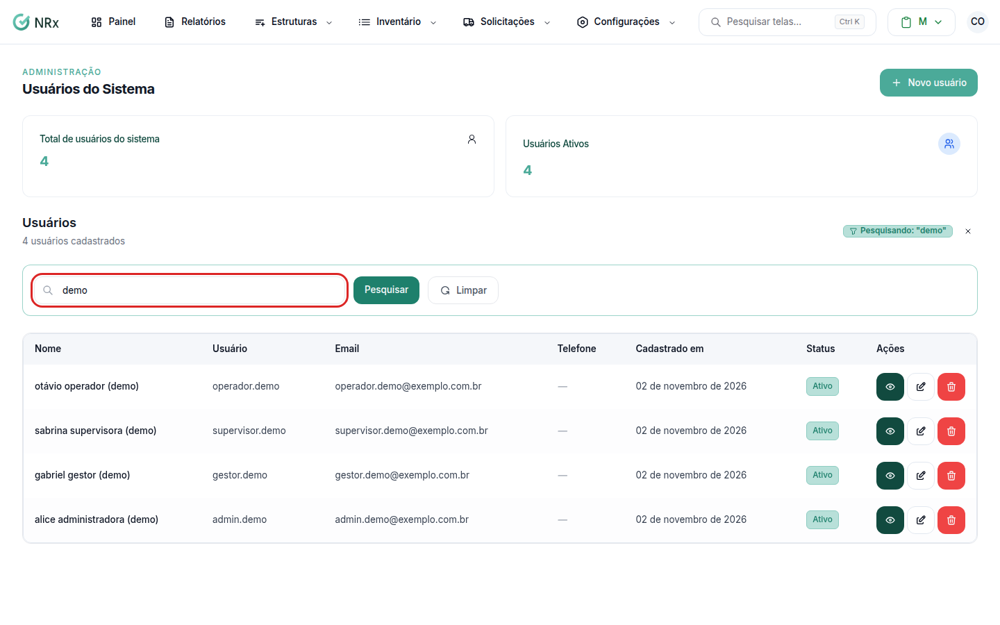
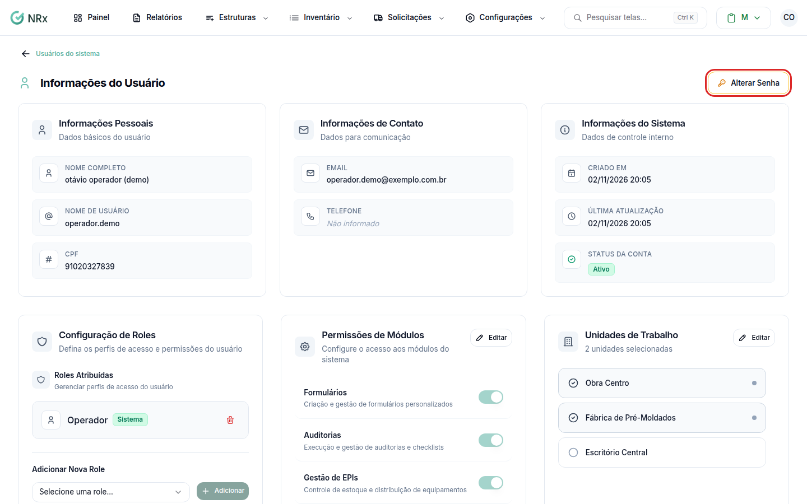
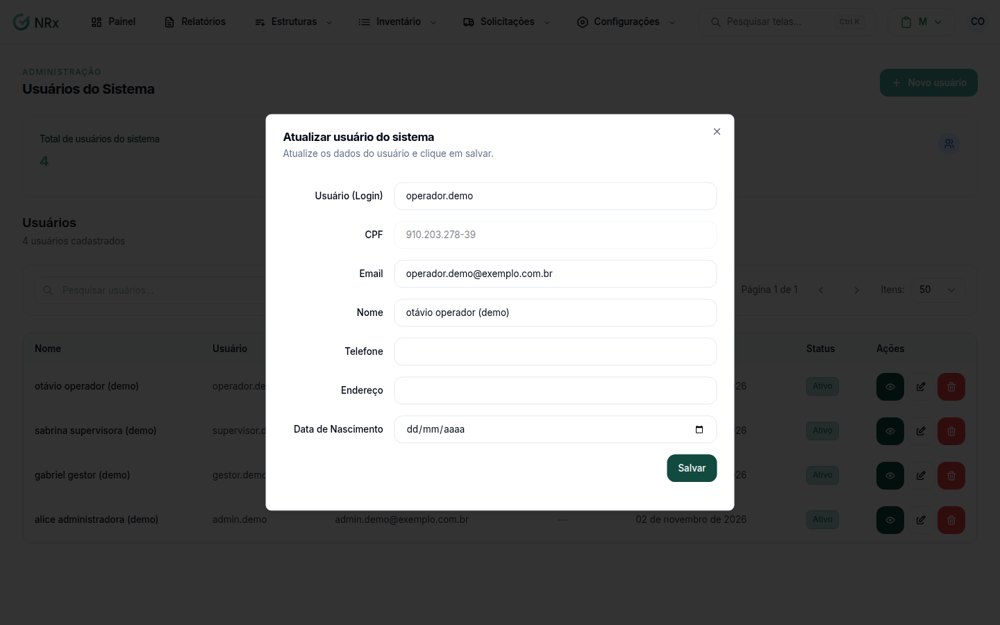
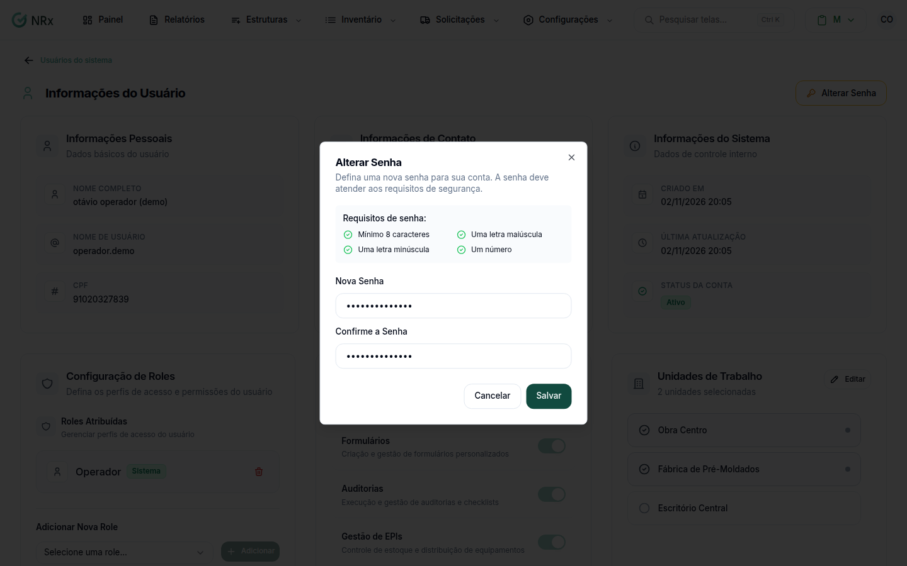

# Editar um usuário

**Para que serve:** corrigir os dados de um usuário ou trocar a senha dele.


**Quem pode fazer:** Administrador, com a permissão de editar usuários.


## Antes de começar

* O usuário precisa estar cadastrado. Se não estiver, veja [Criar um usuário](criar-usuario.md).

## Passo a passo



### Encontre o usuário

Clique em **Estruturas › Usuários**. Digite em **Pesquisar usuários...** o nome, o usuário, o e-mail ou o telefone.

<figure><figcaption>
Pesquisa de usuários
</figcaption></figure>



### Abra o usuário

Clique no usuário na lista. Abre o detalhe, com os cartões **Informações do Usuário**, **Alterar Senha**, **Unidades de Trabalho**, **Permissões de Módulos** e **Roles Atribuídas**.

<figure><figcaption>
Detalhe do usuário
</figcaption></figure>



### Corrija os dados

No cartão **Informações do Usuário**, abra a edição. Na janela **Atualizar usuário do sistema**, corrija o que precisar e salve. Aparece **Atualizado com sucesso!**.

<figure><figcaption>
Janela Atualizar usuário do sistema
</figcaption></figure>



### Troque a senha (se precisar)

No cartão **Alterar Senha**, digite a nova senha e salve. Aparece **Senha alterada com sucesso!**.

A senha precisa ter no mínimo 8 caracteres, com letra maiúscula, letra minúscula e número.

<figure><figcaption>
Cartão Alterar Senha
</figcaption></figure>



## Deu errado?


**"Não é possível alterar a senha de um parceiro."**: usuários com o selo **Parceiro** não podem ter a senha trocada aqui.


## Dúvidas comuns

A pessoa esqueceu a senha. Preciso trocar por ela?

Não precisa. Ela mesma pode criar uma nova pela [recuperação de senha](../../acesso/esqueci-minha-senha.md).

Posso mudar o login do usuário?

O login é único em toda a GNRx. Se o novo já existir, aparece **"Esse nome de usuário já está em uso."**.

