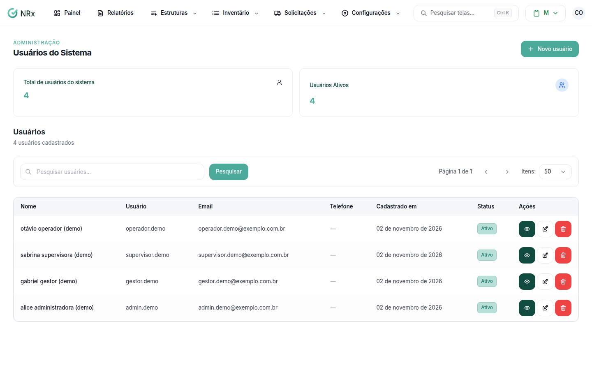
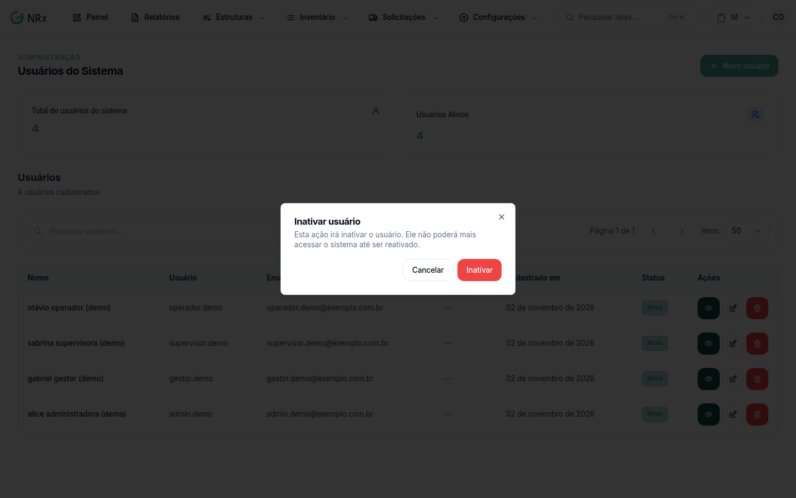

# Inativar ou reativar um usuário

**Para que serve:** bloquear o acesso de quem saiu da empresa ou devolver o acesso depois.


**Quem pode fazer:** Administrador, com a permissão de inativar usuários (para reativar, a permissão de reativar usuários).


## Antes de começar

* Nada a preparar. O histórico do usuário continua guardado.

## Passo a passo



### Encontre o usuário

Clique em **Estruturas › Usuários**. Para achar alguém já inativo, use o filtro **Ativo/Inativo**.

<figure><figcaption>
Lista com filtro Ativo/Inativo
</figcaption></figure>



### Inative

Na coluna **Ações**, escolha inativar. Aparece o aviso: "Esta ação irá inativar o usuário. Ele não poderá mais acessar o sistema até ser reativado."

<figure><figcaption>
Confirmação da inativação
</figcaption></figure>



### Confirme

Confirme. Aparece **Usuário inativado**. Para reativar, faça o mesmo caminho.



## Dúvidas comuns

A pessoa é desconectada na hora?

O bloqueio vale a partir do próximo acesso.

Dá para excluir o usuário de vez?

Não. Só existe inativar e reativar.

