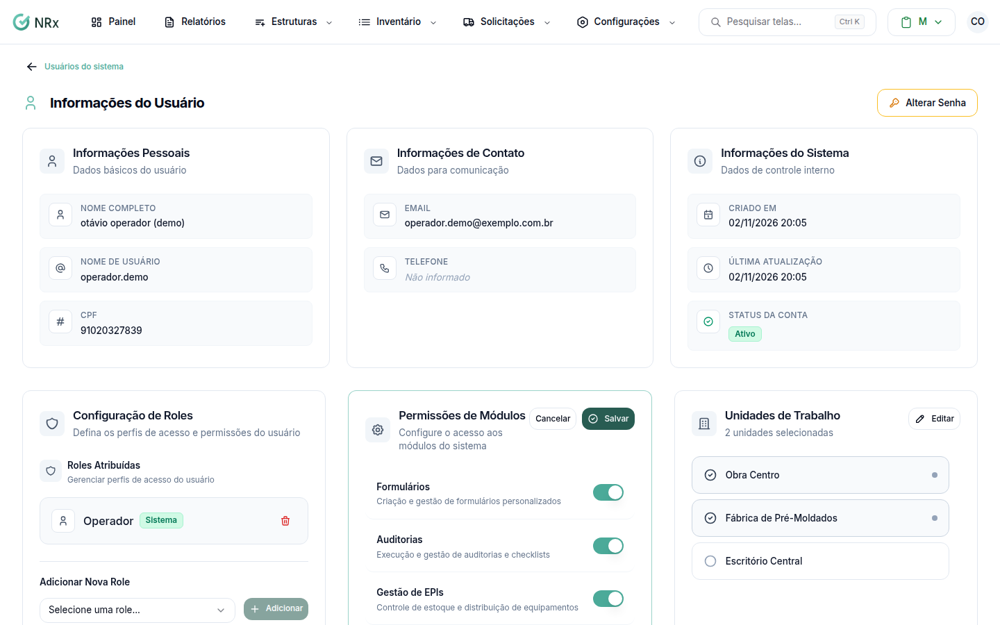

# Liberar módulos para um usuário

**Para que serve:** ligar ou desligar os módulos que o usuário pode usar.


**Quem pode fazer:** Administrador, com a permissão de editar usuários.


## Antes de começar

* O módulo precisa ter sido contratado pela sua empresa.

## Passo a passo



### Abra o usuário

Clique em **Estruturas › Usuários**. Na coluna **Ações** do usuário, clique no ícone de olho.



### Ligue ou desligue os módulos

No cartão **Permissões de Módulos**, clique em **Editar**. Ligue ou desligue cada módulo. O DDS (Diálogo Diário de Segurança) também aparece aqui.

<figure><figcaption>
Permissões de módulos
</figcaption></figure>



### Salve

Clique em **Salvar**. Aparece **Permissões atualizadas com sucesso!**.




A pessoa só acessa um módulo se a empresa contratou **e** o módulo está ligado no cadastro dela.


## Deu errado?


**O módulo aparece como "Indisponível" e não liga**: a sua empresa não contratou esse módulo.


## Dúvidas comuns

A pessoa vê "O usuário não possui permissão para acessar nenhum módulo." ao entrar. Por quê?

Nenhum módulo está ligado no cadastro dela. Ligue pelo menos um.

Ligar o módulo já libera tudo dentro dele?

Não. O que a pessoa pode fazer dentro do módulo depende da role. Veja [Entender as roles](o-que-sao-roles.md).

