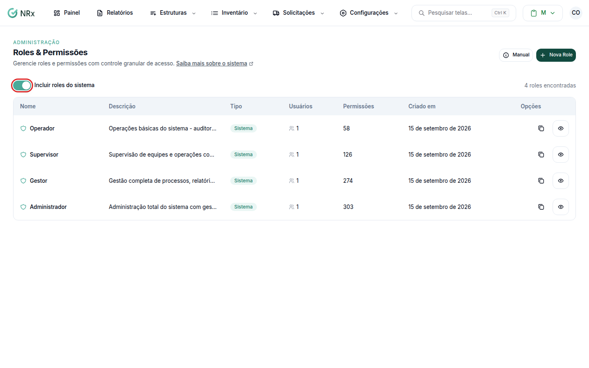

# Entender as roles

**Para que serve:** saber o que cada role pode fazer, para escolher a certa para cada pessoa.


**Quem pode fazer:** qualquer pessoa pode ler esta página. Para ver as roles no sistema, você precisa da permissão de ver roles (Administrador).


## Antes de começar

* Uma **role** é um pacote de permissões. Você dá uma role ao usuário e ele ganha tudo o que está nela.
* As roles ficam em **Configurações › Roles & Permissões** (no Treinamento, **Configurações › Roles e Permissões**), dentro de qualquer módulo.

<figure><figcaption>
Tela de roles
</figcaption></figure>

## Quem pode o quê

| Role | O que pode fazer |
| --- | --- |
| **Operador** | O dia a dia: faz auditoria, preenche formulário, pede EPI, registra ocorrência, vê o DDS e o próprio treinamento. |
| **Supervisor** | Tudo do Operador, mais: entrega e devolve EPI, aprova solicitações e compras, conduz o DDS, investiga ocorrências, conduz a eleição e as reuniões da CIPA, cuida de turmas e matrículas e vê os painéis. |
| **Gestor** | Quase tudo. **Não pode:** mexer em usuários e roles, criar ou inativar estruturas (unidade, setor, cargo, turno, terceiro) e colaboradores, gerenciar o estoque de EPI, mudar as configurações da empresa e o WhatsApp, ver as denúncias da CIPA e invalidar certificado. |
| **Administrador** | Tudo. |
| **Acesso Empresa (CNPJ)** | Tudo, sem depender de role. |

Quer a lista completa, permissão por permissão? Veja [Consultar as permissões](sistema-permissoes-roles.md).


Quem não tem as permissões de ver "de todos" vê só o que criou ou o que foi atribuído a ele.


## Dúvidas comuns

Posso mudar as permissões do Operador?

Não. As 4 roles com o selo **Sistema** não podem ser editadas nem excluídas. Para ter uma versão própria, [crie uma role](criar-role.md) a partir dela.

O que é o selo Customizada?

É uma role criada pela sua empresa. Ela pode ser editada e excluída.

Dá para dar uma role só para um setor?

Não. Hoje, o que limita o que a pessoa vê são as [unidades vinculadas a ela](vincular-unidades.md).

