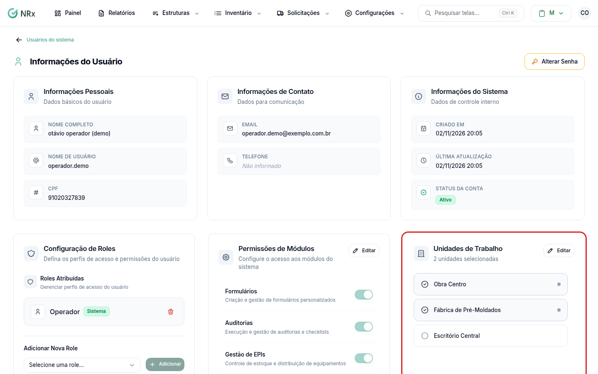
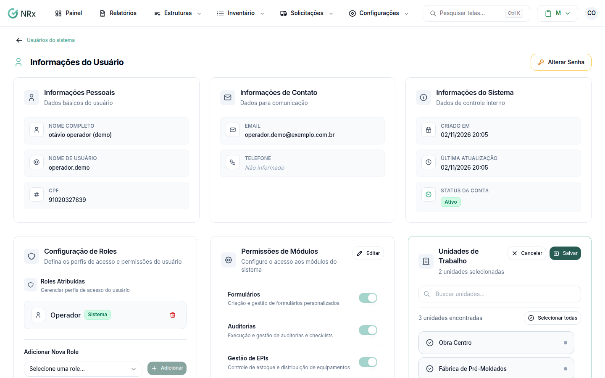

# Vincular unidades a um usuário

**Para que serve:** definir em quais unidades o usuário trabalha. Ele só vê os registros dessas unidades.


**Quem pode fazer:** Administrador, com a permissão de editar usuários.


## Antes de começar

* Cadastre as [unidades](../unidades/README.md) primeiro.

## Passo a passo



### Abra o usuário

Clique em **Estruturas › Usuários** e depois no usuário.

<figure><figcaption>
Cartão Unidades de Trabalho
</figcaption></figure>



### Marque as unidades

No cartão **Unidades de Trabalho**, clique em **Editar**. Marque as unidades. Se quiser, use **Selecionar todas** ou **Desmarcar todas**.

<figure><figcaption>
Unidades em edição
</figcaption></figure>



### Salve

Clique em **Salvar**. Aparece **Unidades atualizadas com sucesso!**.




Deixe pelo menos uma unidade marcada. Sem unidade, a pessoa não vê os registros na maioria das telas.


## Dúvidas comuns

Dá para limitar o acesso por setor?

Não. Hoje, o que limita o que a pessoa vê são as unidades vinculadas a ela.

Quando a mudança vale?

Assim que você salva.

