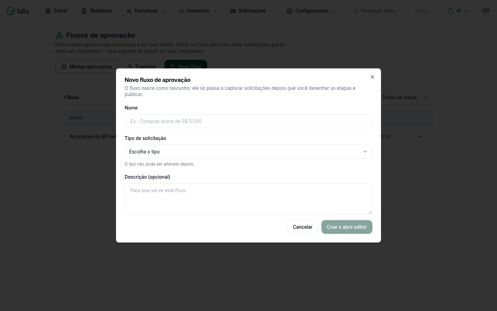
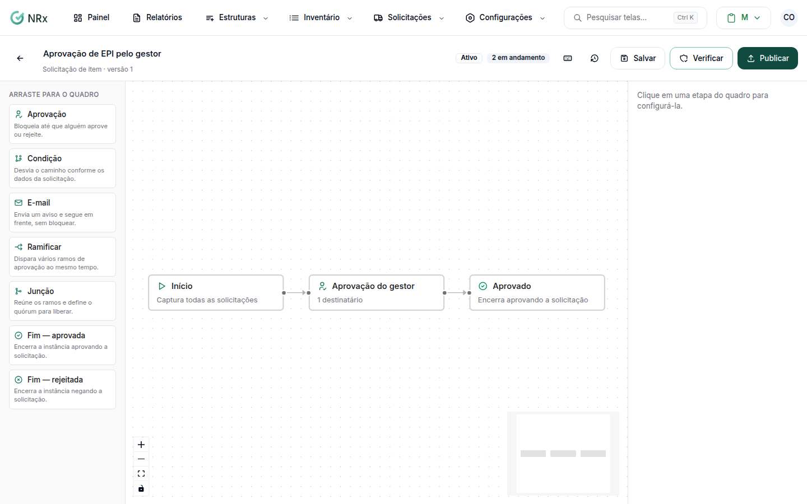

# Criar um fluxo de aprovação

**Para que serve:** desenhar as etapas de aprovação de um tipo de solicitação e publicar.


**Quem pode fazer:** Gestor ou Administrador, com a permissão de criar, editar, publicar, pausar e excluir fluxos de aprovação.


## Antes de começar

* Decida o tipo: **Solicitação de itens**, **Solicitação de compra**, **Solicitação de transferência**, **Análise de documento** ou **Liberação documental excepcional**. O tipo não pode ser alterado depois.

## Passo a passo



### Crie o fluxo

Clique em **Configurações › Fluxos de Aprovação** e depois em **Novo fluxo**. Dê um nome (ex.: Compras acima de R$ 5.000), escolha o **Tipo de solicitação** e, se quiser, a descrição.

<figure><figcaption>
Novo fluxo de aprovação
</figcaption></figure>



### Desenhe as etapas

No editor, arraste os blocos de **Arraste para o quadro**, a partir do **Início** (define quais solicitações o fluxo captura):

* **Aprovação:** bloqueia até que alguém aprove ou rejeite. Escolha **Quem aprova** (ou "Quem decide é o supervisor do colaborador", só em solicitação de itens). Se quiser, escreva **Instruções** e ligue **Exigir motivo na rejeição**.
* **Condição:** desvia o caminho conforme os dados da solicitação. **Quando** **Todas as regras forem verdadeiras** ou **Qualquer regra for verdadeira**.
* **Ramificar:** dispara vários ramos de aprovação ao mesmo tempo.
* **Junção:** reúne os ramos e define o quórum para liberar (**Todos os ramos aprovarem**, **O primeiro ramo aprovar** ou **Um número mínimo de ramos aprovar**).
* **E-mail:** envia um aviso e segue em frente, sem bloquear.
* **Fim — aprovada** e **Fim — rejeitada:** encerram a solicitação.

<figure><figcaption>
Editor de fluxo
</figcaption></figure>



### Salve e publique

Clique em **Salvar rascunho**. Quando estiver pronto, clique em **Publicar**. Aparece "Fluxo publicado": a partir de agora ele captura as solicitações novas que baterem com os critérios.



## Deu errado?

| Mensagem na tela | O que fazer |
| --- | --- |
| "O fluxo ainda tem pendências" | Veja a lista abaixo do quadro e corrija. |
| **Critérios em conflito** | Outro fluxo publicado pega as mesmas solicitações. Ajuste os critérios. |
| "Uma condição precisa de ao menos uma regra." | Adicione uma regra na condição. |

## Dúvidas comuns

Mudei o fluxo. As solicitações em andamento mudam?

Não. As alterações só valem para solicitações novas depois de publicar.

Como paro um fluxo?

Na lista, em **Ações do fluxo**, use **Pausar**: novas solicitações não são mais capturadas, e as que já estavam rodando seguem até o fim. Para voltar, **Reativar**. **Excluir** também deixa as em andamento terminarem.

