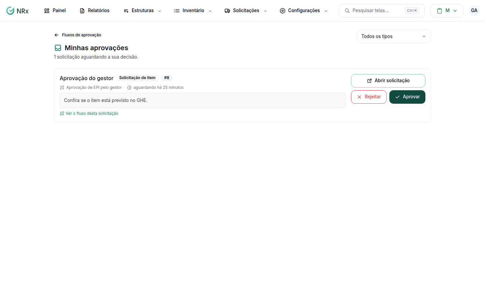

# Decidir uma aprovação

**Para que serve:** aprovar ou rejeitar as solicitações que estão esperando a sua decisão.


**Quem pode fazer:** quem foi escolhido como aprovador na etapa, com a permissão de decidir as etapas de aprovação atribuídas a si (Supervisor, Gestor e Administrador).


## Antes de começar

* Nada a preparar.

## Passo a passo



### Abra Minhas aprovações

Clique em **Configurações › Minhas Aprovações**. Filtre por **Tipo de solicitação**, se quiser.

<figure><figcaption>
Minhas aprovações
</figcaption></figure>



### Confira

Use **Abrir solicitação** para ver os detalhes ou **Ver o fluxo desta solicitação** para ver as etapas.



### Decida

Clique em **Aprovar** e em **Confirmar Aprovação**. Aparece "Etapa aprovada": a solicitação seguiu para a próxima etapa. Ou clique em **Rejeitar**, escreva o motivo (se a etapa exige) e clique em **Confirmar Rejeição**.




Rejeitar encerra a solicitação inteira, inclusive as etapas paralelas pendentes.


## Deu errado?

| Mensagem na tela | O que fazer |
| --- | --- |
| "Você não está entre os aprovadores" | Esta etapa foi configurada para outras pessoas decidirem. |
| "Etapa já decidida" | Alguém decidiu antes ou o fluxo não está mais em andamento. |
| "Esta etapa exige um motivo para a rejeição." | Escreva o motivo. |

## Dúvidas comuns

Apareceu "Nada aguardando você por aqui."

Não há solicitação esperando a sua decisão.

Posso avisar o colaborador?

Se a etapa permitir, aparecem **Notificar via aplicativo** e **Notificar por email**.

