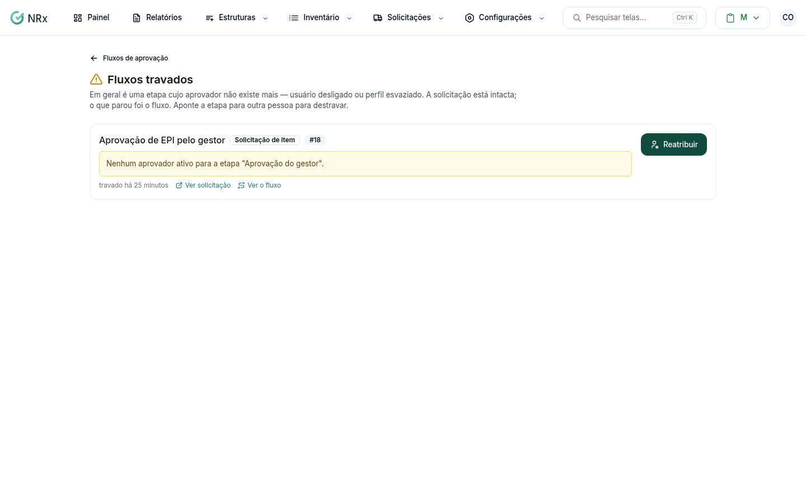

# Destravar um fluxo

**Para que serve:** reatribuir as etapas de fluxos que travaram sem aprovador, para a solicitação seguir.


**Quem pode fazer:** Gestor ou Administrador, com a permissão de reatribuir etapas de fluxos que travaram sem aprovador.


## Antes de começar

* Nada a preparar.

## Passo a passo



### Abra os travados

Clique em **Configurações › Fluxos Travados**.

<figure><figcaption>
Fluxos travados
</figcaption></figure>



### Reatribua

Use **Ver solicitação** ou **Ver o fluxo** para entender. Clique em **Reatribuir** e escolha quem vai decidir.



## Dúvidas comuns

Apareceu "Nenhum fluxo travado."

Todas as etapas têm aprovador.

Por que um fluxo trava?

Quando a etapa fica sem aprovador apto (ex.: o supervisor saiu). No editor, a etapa de supervisor tem a opção **Quando não há supervisor apto**.

