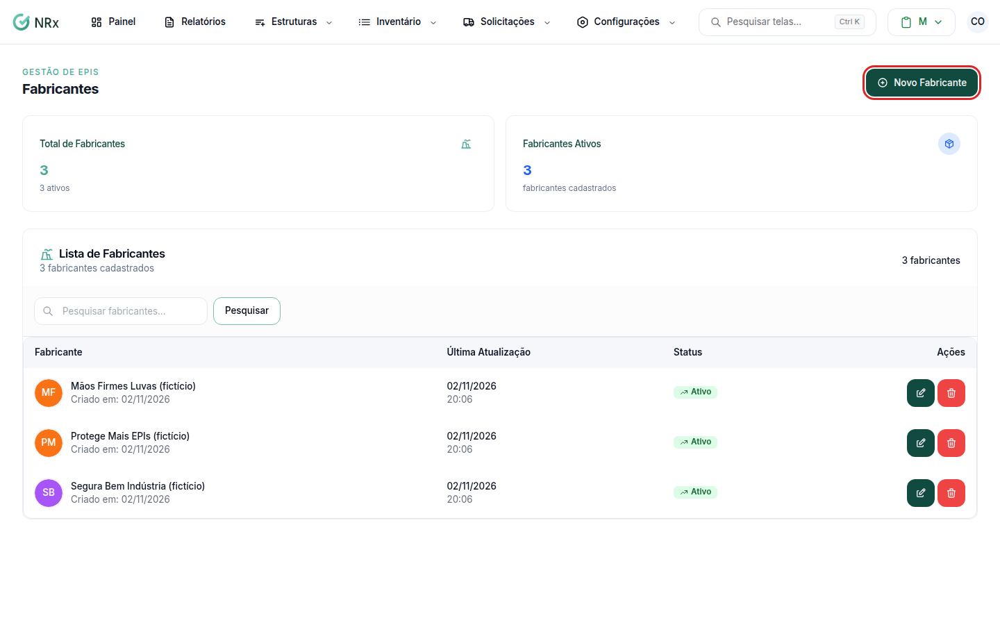

# Cadastrar um fabricante

**Para que serve:** cadastrar os fabricantes de EPI, para usar no cadastro dos itens.


**Quem pode fazer:** Gestor ou Administrador, com a permissão de cadastrar fabricantes de EPI. Todas as roles podem ver.


## Antes de começar

* Na busca pelo CA, o fabricante pode ser criado na hora. Veja [Cadastrar um EPI](../itens/criar-item-com-ca.md).

## Passo a passo



### Clique em Novo Fabricante

Clique em **Inventário › Gerenciar Fabricantes** e depois em **Novo Fabricante**. Abre **Criar Fabricante**.

<figure><figcaption>
Fabricantes
</figcaption></figure>



### Salve

Digite o **Nome** e clique em **Salvar**. Aparece "Fabricante criado com sucesso".



## Deu errado?


**"Nome muito longo"**: encurte o nome.


## Dúvidas comuns

Como corrijo o nome?

Use **Atualizar Fabricante** e salve. Aparece "Fabricante atualizado com sucesso".

Como tiro um fabricante?

Use **Inativar Fabricante** e confirme. Aparece "Fabricante excluído com sucesso!". O fabricante fica inativo.

