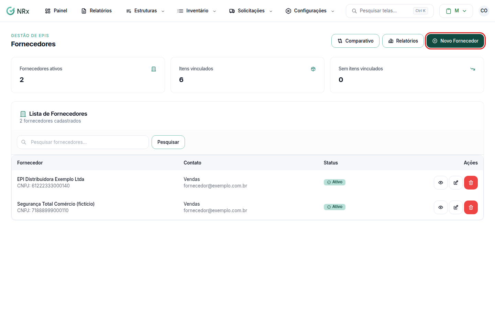

# Cadastrar um fornecedor

**Para que serve:** cadastrar quem vende EPIs e produtos para a empresa, para comparar preços e usar nas compras.


**Quem pode fazer:** Supervisor, Gestor ou Administrador, com a permissão de criar fornecedor.


## Antes de começar

* Tenha o nome (razão social), o CNPJ ou CPF e o contato.

## Passo a passo



### Clique em Novo Fornecedor

Clique em **Inventário › Gerenciar Fornecedores** e depois em **Novo Fornecedor**.

<figure><figcaption>
Fornecedores
</figcaption></figure>



### Preencha e salve

Preencha o **Nome** (razão social ou nome), o **CNPJ** ou **CPF**, o **E-mail**, o **Telefone**, o **Contato responsável**, o **Código de integração**, o **Endereço** e a **Observação**. Salve. Aparece "Fornecedor criado com sucesso".



Depois, [vincule os itens e os preços](vincular-itens.md).

## Deu errado?


**"E-mail inválido"**: confira o e-mail.


## Dúvidas comuns

Como tiro um fornecedor?

Use **Inativar Fornecedor**. Ele deixa de aparecer nas listagens e comparativos. Aparece "Fornecedor inativado com sucesso!".

Como corrijo os dados?

Use **Editar Fornecedor** e salve. Aparece "Fornecedor atualizado com sucesso".

