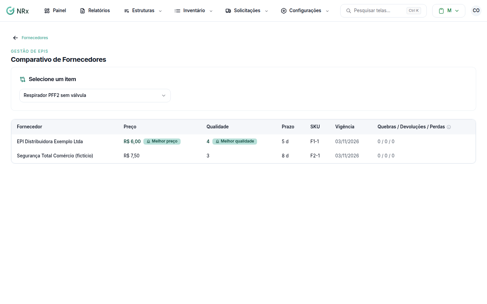

# Comparar fornecedores

**Para que serve:** comparar os fornecedores de um item por preço, qualidade e prazo, e ver os relatórios de compras.


**Quem pode fazer:** Supervisor, Gestor ou Administrador, com a permissão de ver fornecedores, comparativos e relatórios.


## Antes de começar

* [Vincule os itens](vincular-itens.md) aos fornecedores.

## Passo a passo



### Abra o comparativo

Em **Fornecedores**, clique em **Comparativo** e selecione o item. Veja o **Melhor preço**, a **Melhor qualidade**, o prazo, o SKU, a vigência e as **Quebras / Devoluções / Perdas**.

<figure><figcaption>
Comparativo de Fornecedores
</figcaption></figure>



### Veja os relatórios

Clique em **Relatórios**. Escolha: **Melhor preço**, **Ranking**, **Compras**, **Preço histórico**, **Estoque**, **Dependência**, **Lotes problemáticos** ou **Ressarcimento**.



## Dúvidas comuns

Apareceu "Nenhum fornecedor tem preço vigente para este item."

Vincule o item a um fornecedor com vigência atual.

Inativei um fornecedor. Ele aparece no comparativo?

Não. O fornecedor inativo deixa de aparecer nas listagens e comparativos.

