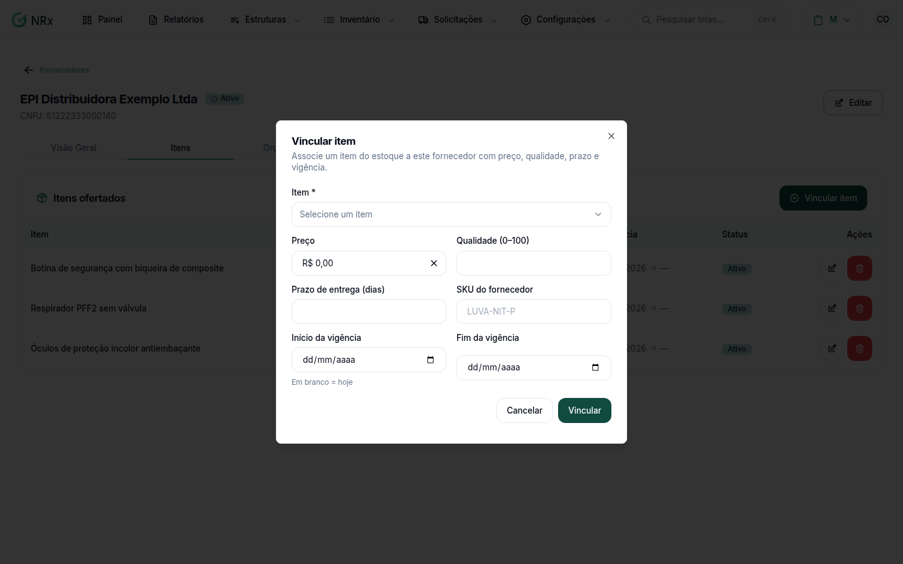

# Vincular itens a um fornecedor

**Para que serve:** registrar o preço, a qualidade e o prazo de cada item no fornecedor, para comparar e comprar melhor.


**Quem pode fazer:** Supervisor, Gestor ou Administrador, com a permissão de vincular e precificar itens do fornecedor.


## Antes de começar

* [Cadastre o fornecedor](cadastrar-fornecedor.md) e o item.

## Passo a passo



### Abra o fornecedor

Clique em **Inventário › Gerenciar Fornecedores** e abra o fornecedor. Clique em **Vincular item**.

<figure><figcaption>
Vincular item
</figcaption></figure>



### Preencha

Escolha o **Item** e informe o **Preço**, a **Qualidade (0–100)**, o **Prazo de entrega (dias)** e o **SKU do fornecedor**. Informe o **Início da vigência** (em branco = hoje) e, se quiser, o **Fim da vigência**. Clique em **Vincular**. Aparece "Item vinculado ao fornecedor.".



## Deu errado?

| Mensagem na tela | O que fazer |
| --- | --- |
| "Selecione um item" | Escolha o item. |
| "Máximo 100" | A qualidade vai de 0 a 100. |
| "O fim da vigência não pode ser antes do início" | Confira as datas. |

## Dúvidas comuns

Como tiro um item do fornecedor?

Use **Remover vínculo**. O preço deixa de ser considerado nos comparativos.

O preço mudou.

Edite o vínculo e salve. Aparece "Vínculo atualizado.".

