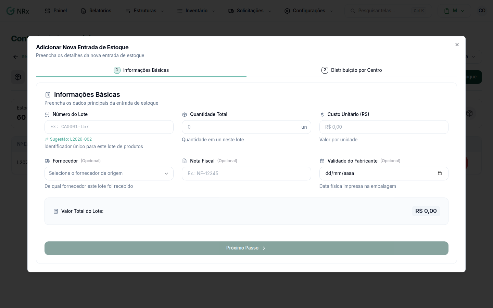

# Dar entrada no estoque

**Para que serve:** registrar a chegada de um item: quantidade, custo, lote, fornecedor e para quais centros de estoque vai.


**Quem pode fazer:** Administrador, com a permissão de gerenciar o estoque de EPIs.


## Antes de começar

* O item precisa estar cadastrado. Se tiver variantes (ex.: tamanho), cadastre-as antes.

## Passo a passo



### Abra a entrada

Abra o item e clique em **Adicionar Estoque**. Abre **Adicionar Nova Entrada de Estoque**.

<figure><figcaption>
Adicionar Nova Entrada de Estoque
</figcaption></figure>



### Informações básicas

Preencha o número do lote (ex.: CA0001-L57), a **Quantidade Total**, o **Custo Unitário (R$)**, o fornecedor de origem, a nota fiscal (ex.: NF-12345) e a data do fabricante. Clique em **Próximo Passo**.



### Distribua

Se o item tem variantes, distribua a quantidade por **Adicionar Combinação**. Depois, distribua por centro de estoque: use **Todo restante**, **Dividir igualmente** ou **Quantidade fixa** e clique em **Aplicar**.



### Confirme

Clique em **Confirmar Entrada**. Aparece "Entrada de estoque registrada com sucesso!".



## Deu errado?

| Mensagem na tela | O que fazer |
| --- | --- |
| "Este número de lote já existe no sistema" | Use outro número de lote. |
| "Você precisa distribuir os itens em pelo menos uma unidade" | Distribua a quantidade. |
| **Corrija as Duplicatas** / **Ajuste as Quantidades** | Confira as combinações de variantes. |

## Dúvidas comuns

Recebi pela nota fiscal eletrônica.

Use **Ações › Importar via NF-e XML**. Veja [Importar estoque pela NF-e](importar-nfe.md).

Errei a nota fiscal do lote.

Abra o lote e use **Editar Nota Fiscal** (ou **Remover Nota Fiscal**).

