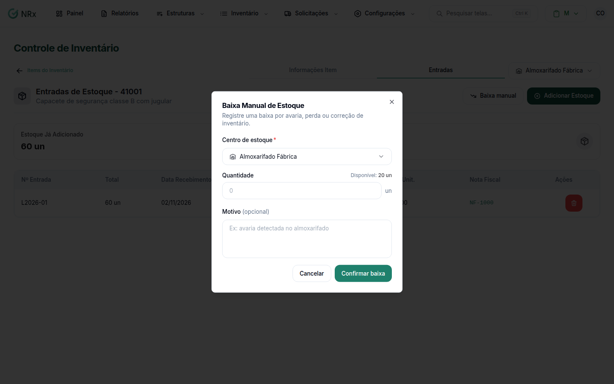

# Fazer uma baixa manual

**Para que serve:** tirar do estoque uma quantidade que não vai ser entregue (ex.: avaria detectada no almoxarifado).


**Quem pode fazer:** Administrador, com a permissão de gerenciar o estoque de EPIs.


## Antes de começar

* Abra o item.

## Passo a passo



### Abra a baixa

No item, clique em **Baixa manual**. Abre **Baixa Manual de Estoque**.

<figure><figcaption>
Baixa Manual de Estoque
</figcaption></figure>



### Confirme

Informe a quantidade e o motivo (ex.: avaria detectada no almoxarifado). Clique em **Confirmar baixa**. Aparece "Baixa registrada": "O estoque foi atualizado com sucesso.".



## Deu errado?

| Mensagem na tela | O que fazer |
| --- | --- |
| "Informe a quantidade" | Preencha a quantidade. |
| "Quantidade deve ser maior que 0" | Ajuste a quantidade. |

## Dúvidas comuns

Como exporto as movimentações?

Use **Ações › Relatórios** e exporte as movimentações.

E se o EPI foi perdido por um colaborador?

Registre a perda na devolução do colaborador.

