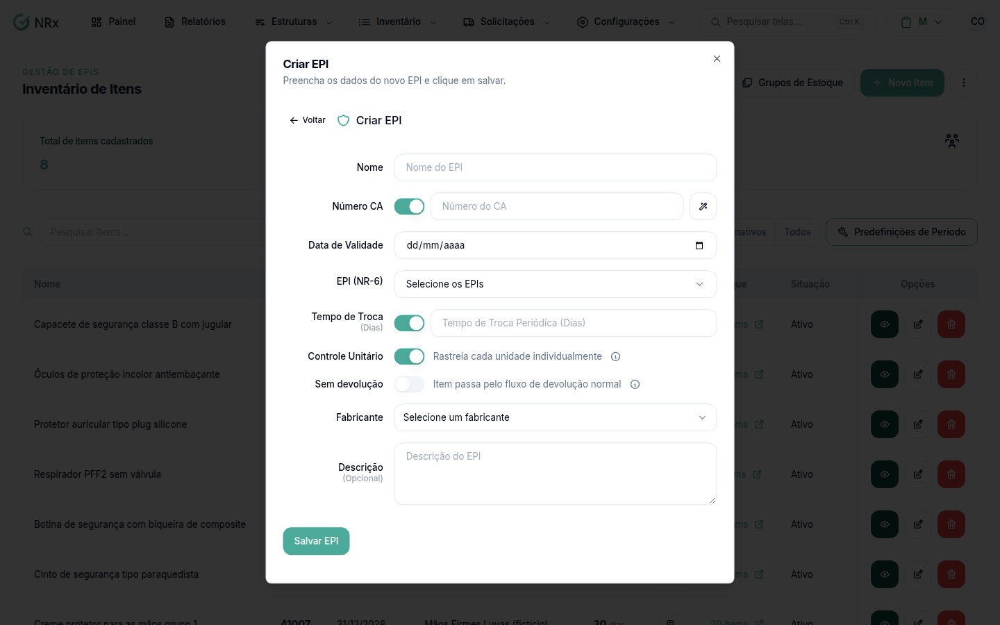

# Cadastrar um EPI

**Para que serve:** cadastrar um EPI com Certificado de Aprovação (CA) no inventário.


**Quem pode fazer:** Gestor ou Administrador, com a permissão de cadastrar novos itens de EPI.


## Antes de começar

* Tenha o número do CA.

## Passo a passo



### Clique em Novo Item

Clique em **Inventário › Gerenciar Inventário** e depois em **Novo Item**. Escolha **EPI** (equipamento com CA obrigatório).

<figure><figcaption>
Criar EPI
</figcaption></figure>



### Preencha pelo CA (opcional)

Use **Buscar CA EPI**: digite o número do CA (mín. 3 dígitos). Aparece "Dados preenchidos automaticamente". Se o fabricante não existir, use **Criar Novo**.



### Complete os dados

Confira **Nome**, **Número CA**, **Data de Validade**, **EPI (NR-6)**, **Tempo de Troca (Dias)** e **Fabricante**. Escolha se rastreia cada unidade (**Controle Unitário**) ou só a quantidade, e se é **Sem devolução** (descartável).



### Salve

Clique em **Salvar EPI**. Aparece "EPI criado com sucesso".



## Deu errado?

| Mensagem na tela | O que fazer |
| --- | --- |
| "Selecione pelo menos um EPI (NR-6)" | Escolha o tipo de EPI. |
| "Fabricante é obrigatório" | Escolha ou crie o fabricante. |
| "Data de validade é obrigatória quando há número CA" | Informe a validade do CA. |
| "Sem devolução não pode ser ativado com controle unitário" | Desligue um dos dois. |
| "CA não encontrado" | Confira o número ou preencha à mão. |

## Dúvidas comuns

Tenho muitos EPIs para cadastrar.

Use **Ações › Importar Itens por CA**. Veja [Importar itens por CA](importar-por-ca.md).

E depois de cadastrar?

[Dê entrada no estoque](adicionar-lote.md).

