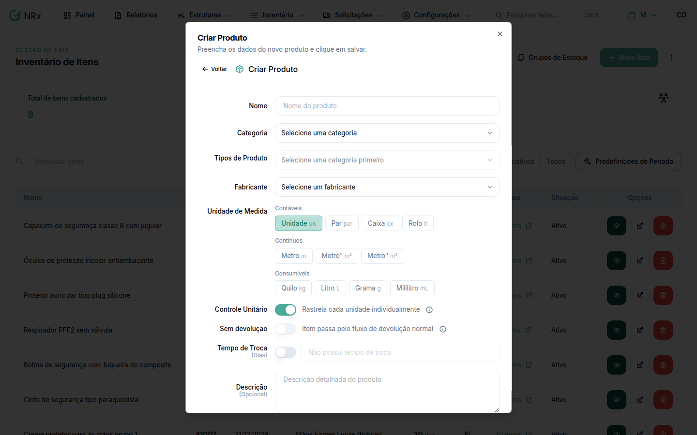

# Cadastrar um produto sem CA

**Para que serve:** cadastrar um item simples, sem CA (uniforme, ferramenta, máquina).


**Quem pode fazer:** Gestor ou Administrador, com a permissão de cadastrar novos itens de EPI.


## Antes de começar

* O tipo de produto precisa existir em [Tipos de produtos](../../configuracoes-gerais/epis/adicionar-epi-catalogo.md).

## Passo a passo



### Clique em Novo Item

Clique em **Inventário › Gerenciar Inventário** e depois em **Novo Item**. Escolha **Produto** (item simples, sem CA).

<figure><figcaption>
Criar Produto
</figcaption></figure>



### Preencha

Informe o nome, a **Categoria**, os **Tipos de Produto** e a **Unidade de Medida** (**Inteiro**, **Uma casa** ou **Três casas** decimais).



### Salve

Clique em **Salvar Produto**. Aparece "Produto criado com sucesso".



## Deu errado?

| Mensagem na tela | O que fazer |
| --- | --- |
| "Categoria é obrigatória" | Escolha a categoria. |
| "Selecione pelo menos um tipo de produto" | Escolha o tipo. |

## Dúvidas comuns

Qual unidade de medida uso?

**Inteiro** para itens contados (1, 2, 5). Casas decimais para itens a granel (0,5 / 1,500).

Tenho muitos produtos.

Use **Ações › Importar Itens em Massa**.

