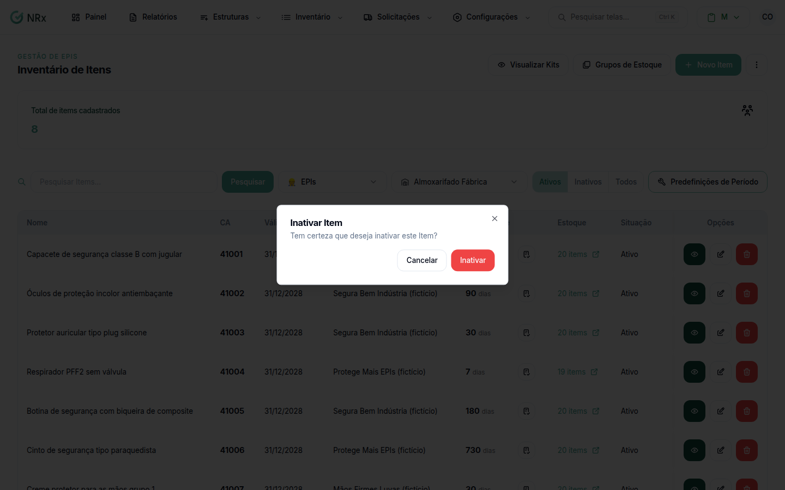

# Inativar ou reativar um item

**Para que serve:** tirar da lista um item que não se usa mais, ou trazer de volta.


**Quem pode fazer:** Gestor ou Administrador, com a permissão de inativar itens de EPI.


## Antes de começar

* Confira se o item é mesmo o certo.

## Passo a passo



### Inative

Na lista, em **Opções**, use **Inativar Item** e confirme: "Tem certeza que deseja inativar este Item?". Aparece "Item excluído com sucesso!".

<figure><figcaption>
Inativar Item
</figcaption></figure>



### Para reativar

Em **Opções**, use **Reativar item**. Aparece "Item reativado com sucesso!".



## Dúvidas comuns

A mensagem diz "excluído". O item foi apagado?

Não. O item fica inativo e pode ser reativado.

Como acho um item inativo?

Pesquise pelo nome. O item inativo aparece com a opção **Reativar item**.

