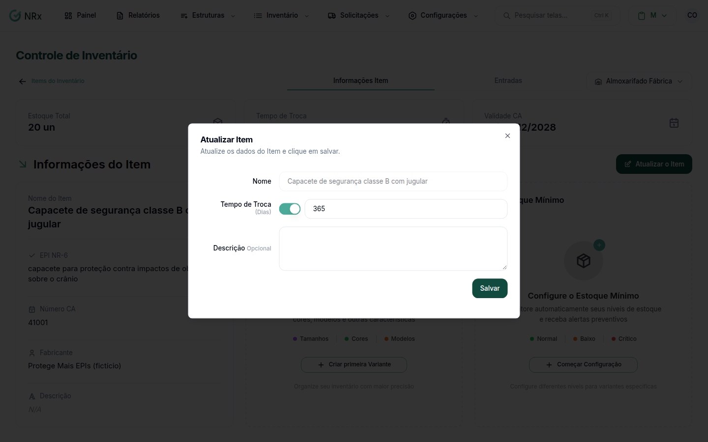

# Editar um item

**Para que serve:** corrigir os dados de um item: nome, CA, validade, tempo de troca, fabricante.


**Quem pode fazer:** Gestor ou Administrador, com a permissão de editar itens de EPI.


## Antes de começar

* [Encontre o item](listar-itens.md).

## Passo a passo



### Abra a edição

Na lista, clique no ícone de lápis, na coluna **Opções**. Abre a edição de EPI ou de Produto, conforme o item.

<figure><figcaption>
Editar item
</figcaption></figure>



### Corrija e salve

Altere o que precisar e salve. Aparece "Item atualizado com sucesso!".



## Deu errado?


**"Não é possível alterar com estoque cadastrado"**: o controle unitário não muda depois que o item tem estoque.


## Dúvidas comuns

O CA venceu. O que faço?

Atualize o número e a data de validade do CA.

Posso mudar o tempo de troca?

Pode. Ou marque **Não possui tempo de troca**.

