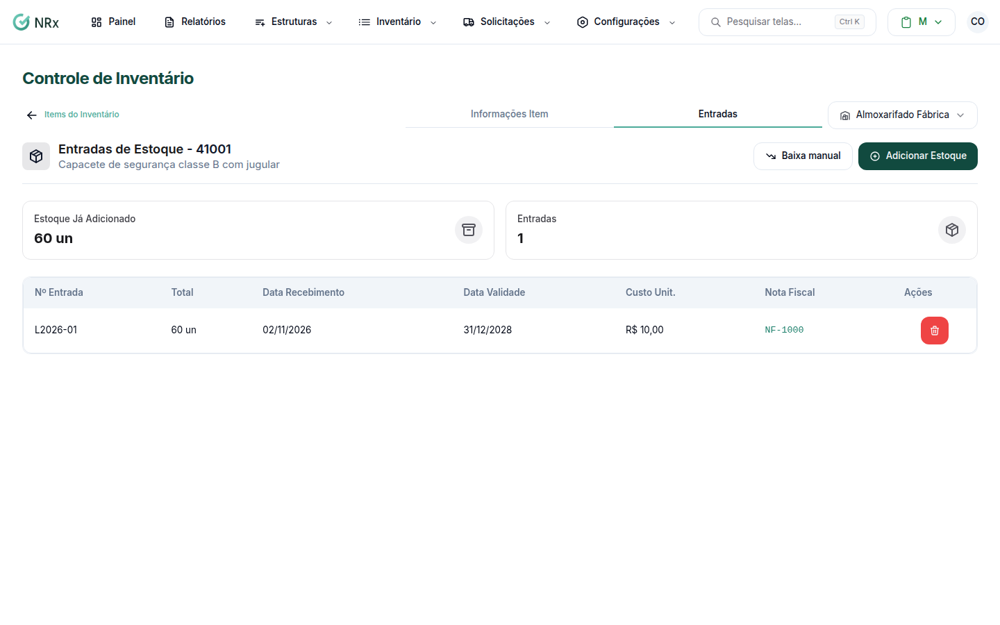

# Ver o estoque de um item

**Para que serve:** ver quanto há de um item em cada centro de estoque, por lote e por unidade.


**Quem pode fazer:** Supervisor, Gestor ou Administrador, com a permissão de ver o estoque de EPIs.


## Antes de começar

* [Encontre o item](listar-itens.md).

## Passo a passo



### Abra o item

Na lista, abra o item. Veja as **Entradas de Estoque** e o estoque por centro.

<figure><figcaption>
Estoque do item
</figcaption></figure>



### Veja as unidades

Abra uma entrada (lote) para ver cada unidade. Use **Pesquisar por número de série...**.



## Dúvidas comuns

Como mudo o estado de uma unidade (ex.: enviar à lavanderia)?

Marque as unidades e escolha o **Novo estado**. Para lavanderia, use **Selecione a lavanderia**. Aparece "Estado alterado com sucesso!".

Como levo o estoque para um relatório?

Use **Ações › Relatórios** (estoque em PDF e movimentações).

