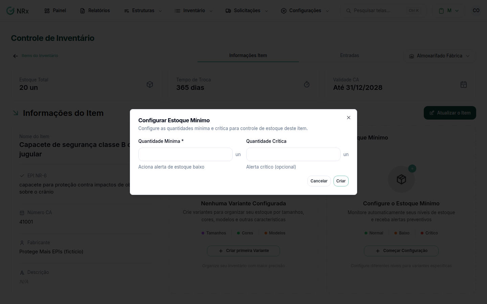

# Definir o estoque mínimo

**Para que serve:** receber alerta quando o estoque de um item fica baixo, em cada centro de estoque.


**Quem pode fazer:** Administrador, com a permissão de gerenciar o estoque de EPIs.


## Antes de começar

* Escolha o centro de estoque.

## Passo a passo



### Abra o estoque mínimo

Abra o item e use **Configurar Estoque Mínimo**.

<figure><figcaption>
Configurar Estoque Mínimo
</figcaption></figure>



### Preencha

Informe a **Quantidade Mínima** (aciona alerta de estoque baixo) e, se quiser, a **Quantidade Crítica** (alerta crítico). Se o item tem variantes, escolha uma variação de cada tipo. Salve. Aparece "Configuração criada com sucesso!".



## Deu errado?

| Mensagem na tela | O que fazer |
| --- | --- |
| "Quantidade crítica deve ser menor que a quantidade mínima" | Ajuste os valores. |
| "Selecione um centro de estoque antes." | Escolha o centro. |
| "Esta combinação de variações já existe" | Edite a configuração existente. |

## Dúvidas comuns

Vários itens equivalentes somam o estoque?

Use um [grupo de estoque](../../configuracoes-iniciais/grupos-estoque/criar-grupo-estoque.md).

Quem recebe o alerta?

Os e-mails da unidade com **Alertas de Estoque Mínimo** marcado.

