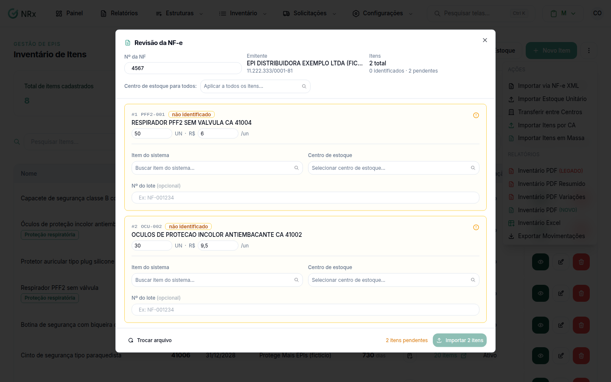

# Importar estoque pela NF-e

**Para que serve:** dar entrada no estoque direto do XML da nota fiscal eletrônica.


**Quem pode fazer:** Administrador, com a permissão de gerenciar o estoque de EPIs.


## Antes de começar

* Tenha o arquivo .xml da NF-e (até 50 MB).

## Passo a passo



### Envie o XML

Clique em **Inventário › Gerenciar Inventário** e em **Ações › Importar via NF-e XML**. Arraste o XML e clique em **Analisar NF-e**.

<figure><figcaption>
Revisão da NF-e
</figcaption></figure>



### Revise

Em **Revisão da NF-e**, confira o **Nº da NF**, o **Emitente** e os **Itens**. Escolha o **Centro de estoque para todos** (ou um por item).

O item da nota que o GNRx não reconheceu aparece como **não identificado**. Em **Item do sistema**, busque e escolha o item correspondente. Se quiser, informe o **Nº do lote**. Enquanto houver itens pendentes, o rodapé mostra quantos faltam.



### Importe

Clique em **Importar** (o botão mostra quantos itens). Aparece **Importação concluída** (ou **Concluído com erros**, com a lista de erros).



## Deu errado?

| Mensagem na tela | O que fazer |
| --- | --- |
| "Selecione um arquivo XML da NF-e" | Envie o arquivo .xml. |
| "Arquivo muito grande (máx. 50MB)" | Use o XML da nota. |
| **Importação falhou** | Confira o arquivo e tente de novo. |

## Dúvidas comuns

Errei o arquivo.

Clique em **Trocar arquivo**.

Concluído com erros. E agora?

Veja os **Erros:** e dê entrada à mão nos itens que falharam.

