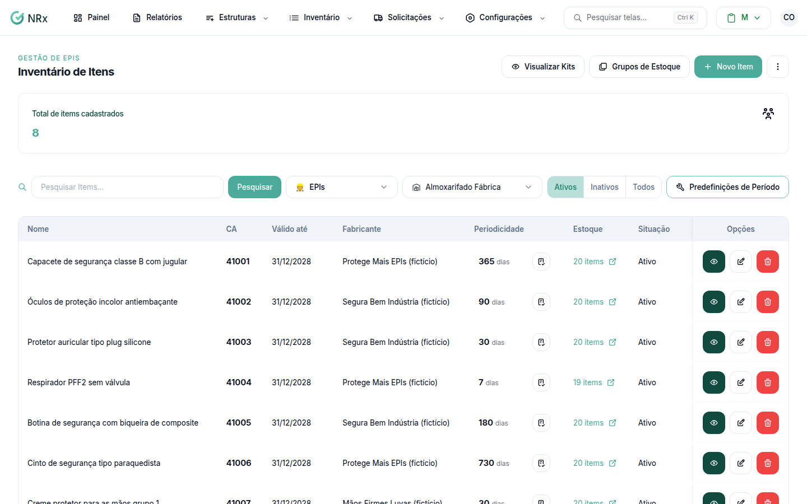

# Encontrar um item

**Para que serve:** achar um item no inventário e ver os alertas de validade do CA.


**Quem pode fazer:** Gestor ou Administrador, com a permissão de ver todos os estoques de EPIs.


## Antes de começar

* Nada a preparar.

## Passo a passo



### Abra o inventário

Clique em **Inventário › Gerenciar Inventário**. Abre **Inventário de Itens**.

<figure><figcaption>
Inventário de Itens
</figcaption></figure>



### Pesquise

Digite em **Pesquisar Items...** (a pesquisa é no nome e no número do item) e clique em **Pesquisar**. Veja os **Alertas de validade**: **VENCIDO**, **CA vence hoje** e **Válido até**.



### Abra o item

Em **Opções**, abra o item para ver o estoque, as entradas e as variantes.



## Dúvidas comuns

Apareceu "Nenhum Item encontrado."

Tente selecionar outro centro de estoque ou remover o filtro.

O que significa "Sem devolução"?

É um item descartável: não aparece no painel de devoluções.

