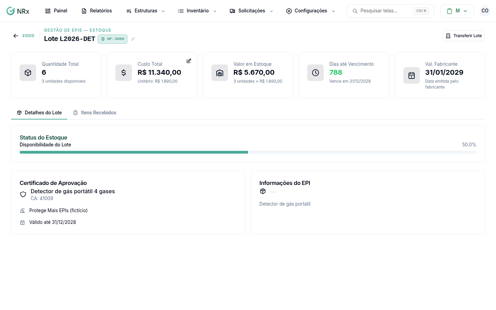

# Ver um lote

**Para que serve:** ver as unidades de uma entrada de estoque, o centro de estoque e a nota fiscal.


**Quem pode fazer:** Supervisor, Gestor ou Administrador, com a permissão de ver o estoque de EPIs.


## Antes de começar

* Abra o item no inventário.

## Passo a passo



### Abra o lote

No item, em **Entradas de Estoque**, abra a entrada.

<figure><figcaption>
Detalhe do lote
</figcaption></figure>



### Pesquise

Use **Pesquisar por número de série...** para achar uma unidade.



## Dúvidas comuns

Como corrijo a nota fiscal do lote?

Use **Editar Nota Fiscal** (ou **Remover Nota Fiscal**).

Apareceu "Nenhum item disponível no inventário."

O lote não tem unidades disponíveis.

