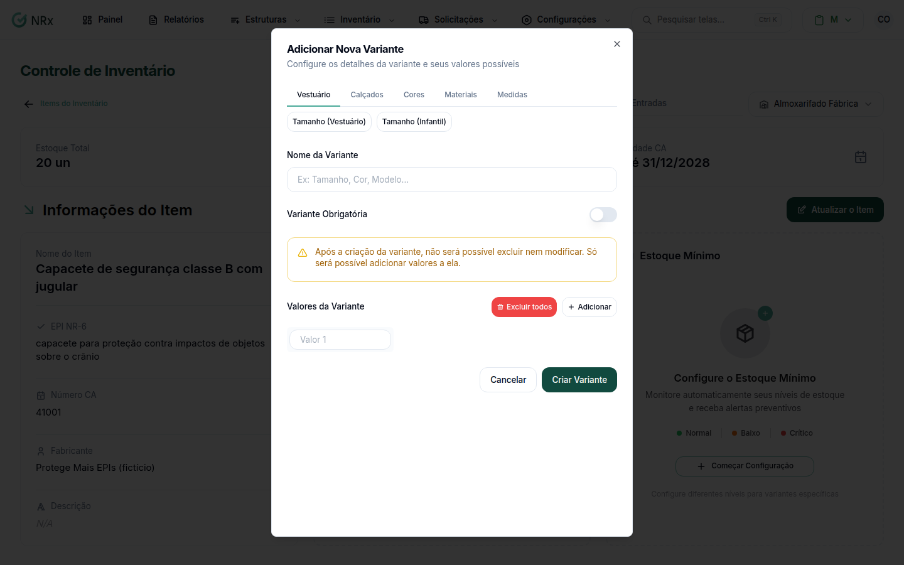

# Criar uma variante

**Para que serve:** criar uma variante num item (ex.: Tamanho, com P, M e G), para separar o estoque.


**Quem pode fazer:** Gestor ou Administrador, com a permissão de editar itens de EPI.


## Antes de começar

* Abra o item no inventário. Crie as variantes antes de dar entrada no estoque.

## Passo a passo



### Abra a variante

No item, clique em **Nova Variante**. Abre **Adicionar Nova Variante**.

<figure><figcaption>
Adicionar Nova Variante
</figcaption></figure>



### Preencha

Dê o **Nome da Variante** (ex.: Tamanho, Cor, Modelo). Se toda entrada precisa dela, ligue **Variante Obrigatória**. Em **Valores da Variante**, digite cada valor e clique em **Adicionar**.



### Crie

Clique em **Criar Variante**. Aparece "Variante criada com sucesso!".



## Deu errado?

| Mensagem na tela | O que fazer |
| --- | --- |
| "Nome da variante é obrigatório" | Dê o nome. |
| "Adicione pelo menos um valor" | Adicione um valor. |
| "Existem valores duplicados" | Tire o repetido. |

## Dúvidas comuns

Esqueci um valor.

Veja [Adicionar valores a uma variante](adicionar-valores-variante.md).

Como uso na entrada?

Na [entrada de estoque](../itens/adicionar-lote.md), distribua a quantidade pelas combinações.

