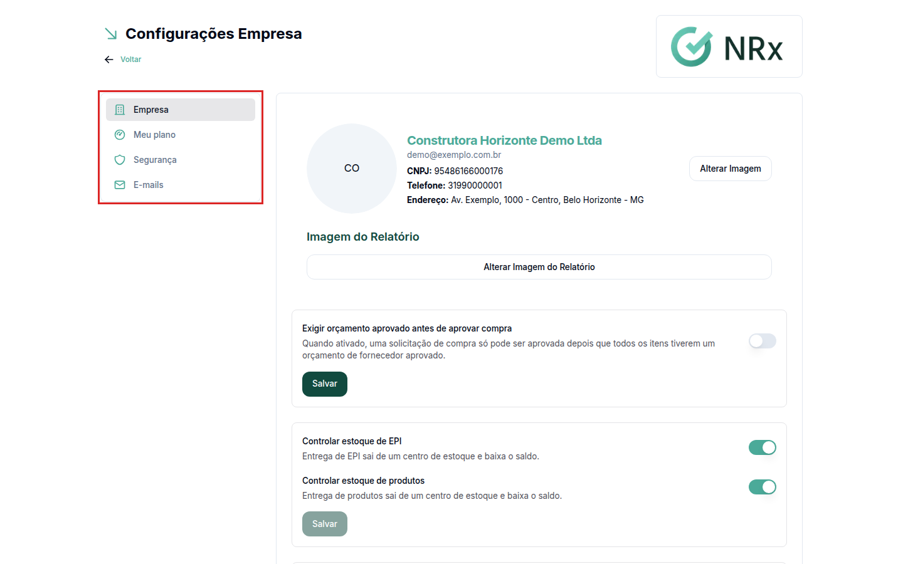

# Minha Empresa

**Para que serve:** cuidar das configurações da empresa no GNRx: logo, plano, segurança e e-mails de aviso.


**Quem pode fazer:** só o acesso Empresa (CNPJ). No canto da tela, abra o menu do usuário e clique em **Minha Empresa**. Abre **Configurações Empresa**, com as abas **Empresa**, **Meu plano**, **Segurança** e **E-mails**.


<figure><figcaption>
Configurações Empresa
</figcaption></figure>

## Comece por aqui

<table data-view="cards"><thead><tr><th></th><th></th><th data-hidden data-card-target data-type="content-ref"></th></tr></thead><tbody><tr><td><strong>Exigir a verificação em duas etapas</strong></td><td>Proteja o login da empresa e dos usuários.</td><td><a href="exigir-verificacao.md">exigir-verificacao.md</a></td></tr><tr><td><strong>Cadastrar os e-mails do SESMT</strong></td><td>Defina quem recebe os avisos do sistema.</td><td><a href="emails-sesmt.md">emails-sesmt.md</a></td></tr></tbody></table>

## Tarefas do dia a dia

<table data-view="cards"><thead><tr><th></th><th></th><th data-hidden data-card-target data-type="content-ref"></th></tr></thead><tbody><tr><td><strong>Alterar o logo da empresa</strong></td><td>Troque o logo e a imagem dos relatórios.</td><td><a href="dados-da-empresa.md">dados-da-empresa.md</a></td></tr><tr><td><strong>Consultar o plano</strong></td><td>Veja os limites contratados e o que já usou.</td><td><a href="meu-plano.md">meu-plano.md</a></td></tr></tbody></table>
