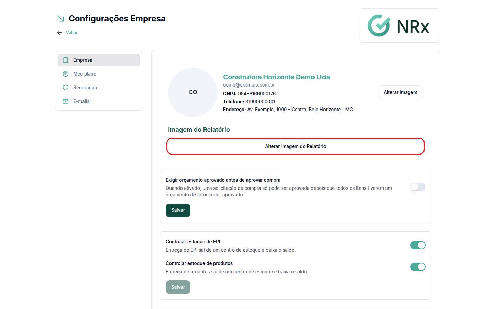

# Alterar o logo da empresa

**Para que serve:** trocar o logo da empresa e a imagem que aparece nos relatórios.


**Quem pode fazer:** só o acesso Empresa (CNPJ).


## Antes de começar

* Tenha a imagem do logo salva no computador.

## Passo a passo



### Abra a aba Empresa

No menu do usuário, clique em **Minha Empresa**. A aba **Empresa** abre primeiro, com as informações da empresa.

<figure><figcaption>
Aba Empresa
</figcaption></figure>



### Troque o logo

Clique em **Alterar logo** e escolha a imagem. Aparece "Logo da empresa atualizado com sucesso.".



### Troque a imagem do relatório (se quiser)

Clique em **Alterar Imagem do Relatório** e escolha a imagem. Aparece "Imagem do relatório atualizada com sucesso.".



## Dúvidas comuns

O que são os outros cartões da aba Empresa?

São as configurações da Gestão de EPIs: estoque, "Exigir orçamento aprovado antes de aprovar compra" e a política do termo no aplicativo. Elas são explicadas no módulo Gestão de EPIs.

Um usuário pode trocar o logo?

Não. Só o acesso Empresa troca o logo e a imagem do relatório.

