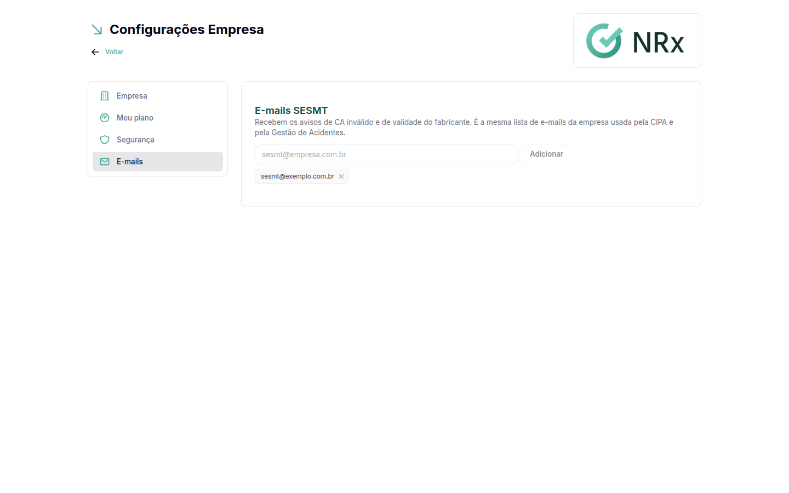

# Cadastrar os e-mails do SESMT

**Para que serve:** definir quem recebe os avisos automáticos do GNRx.

Os E-mails SESMT recebem os avisos gerais de SST da empresa; os e-mails da unidade recebem a operação do EPI daquela unidade; acidentes e treinamentos chegam aos dois. Os dois ficam no mesmo cadastro: SESMT é o e-mail sem unidade.


**Quem pode fazer:** só o acesso Empresa (CNPJ).


## Antes de começar

* A sua empresa precisa ter o módulo Gestão de EPIs. Sem ele, o bloco **E-mails SESMT** não aparece.
* Tenha a lista de e-mails da equipe de segurança do trabalho.

## Passo a passo



### Abra a aba E-mails

No menu do usuário, clique em **Minha Empresa** e depois na aba **E-mails**.



### Informe os e-mails

Em **E-mails SESMT**, digite um e-mail no campo (ex.: sesmt@empresa.com.br) e clique em **Adicionar**. Aparece "E-mail adicionado.". Repita para cada e-mail. Não há botão de salvar: cada e-mail vale assim que é adicionado.

Para tirar um e-mail, clique em remover ao lado dele. Aparece "E-mail removido destes alertas.".


Se aparecer "Nenhum e-mail da empresa recebe estes alertas.", a lista está vazia e ninguém recebe os avisos.


<figure><figcaption>
E-mails SESMT
</figcaption></figure>



## Dúvidas comuns

Que avisos esses e-mails recebem?

Os avisos gerais de SST da empresa: acidentes e ocorrências de todas as unidades; vencimento de treinamento, dúvidas do EAD e avaliação de eficácia; avisos da CIPA (estabilidade, denúncias, SIPAT, contratadas); CA inválido; validade informada pelo fabricante, quando o estoque não é de uma unidade; e documentos da empresa ou da contratada, quando o documento tem "notificar gestores da unidade" ligado.

No módulo Gestão de EPIs, a página **Cadastrar os e-mails da unidade** (em **Estruturas › Unidades**) tem a tabela completa de quem recebe cada aviso.

Posso cadastrar mais de um e-mail?

Pode. Cadastre todos que devem receber os avisos.

