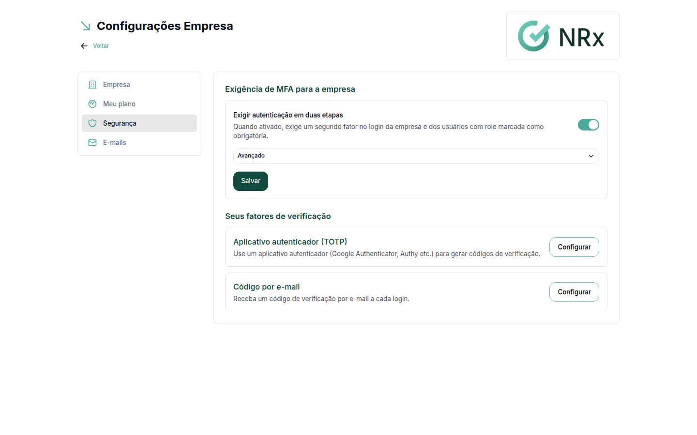
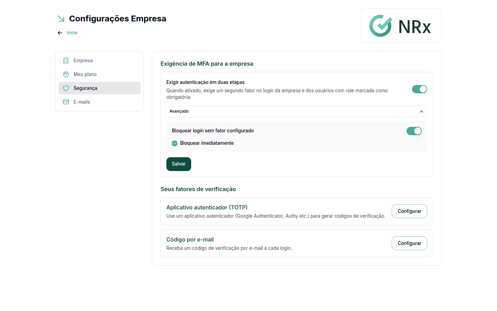

# Exigir a verificação em duas etapas

**Para que serve:** pedir um código, além da senha, no login da empresa e dos usuários com role marcada como **MFA obrigatório**.


**Quem pode fazer:** só o acesso Empresa (CNPJ).


## Antes de começar

* Configure os fatores da própria empresa: [Configurar a verificação em duas etapas](../acesso/verificacao-em-duas-etapas.md).
* Decida quais roles exigem o código. Por padrão, só a role Administrador exige. Nas outras, ligue **MFA obrigatório** ao criar ou editar a role.

## Passo a passo



### Abra a aba Segurança

No menu do usuário, clique em **Minha Empresa** e depois na aba **Segurança**.



### Ligue a exigência

No cartão **Exigência de MFA para a empresa**, ligue **Exigir autenticação em duas etapas**.

<figure><figcaption>
Exigir autenticação em duas etapas
</figcaption></figure>



### Decida se bloqueia quem não configurou

Abra **Avançado** e ligue **Bloquear login sem fator configurado**, se quiser. Escolha **Bloquear imediatamente** ou **Dias de carência** e clique em **Salvar**.

<figure><figcaption>
Opções avançadas
</figcaption></figure>



## O que o usuário vê

| Situação | O que acontece no login |
| --- | --- |
| Exigência ligada, sem bloqueio | O usuário entra e é lembrado de configurar a verificação. |
| Com bloqueio, prazo vencido | Aparece "Configure a autenticação em duas etapas para continuar acessando..." e ele não entra. |

## Dúvidas comuns

Para que servem os dias de carência?

Dão um prazo para os usuários configurarem a verificação antes do bloqueio.

Um usuário foi bloqueado. Como ajudo?

Ele precisa configurar a verificação em **Meu Perfil › Segurança**. Mostre a ele [Configurar a verificação em duas etapas](../acesso/verificacao-em-duas-etapas.md).

