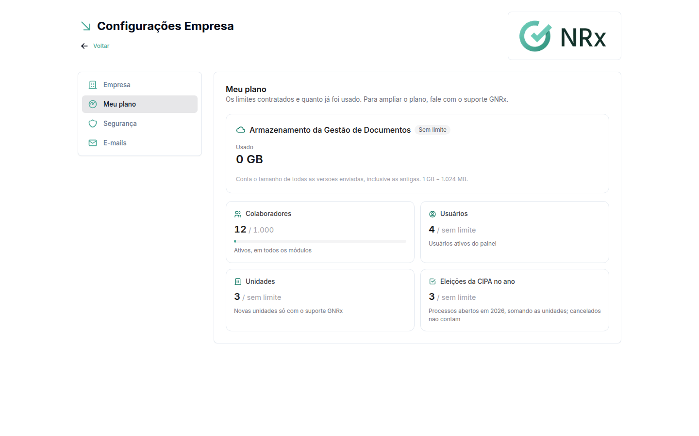

# Consultar o plano

**Para que serve:** ver os limites contratados e quanto a empresa já usou.


**Quem pode fazer:** só o acesso Empresa (CNPJ).


## Antes de começar

* [Entre no sistema](../acesso/entrar-no-sistema.md) pela aba **Empresa**.

## Passo a passo



### Abra a aba Meu plano

No menu do usuário, clique em **Minha Empresa** e depois na aba **Meu plano**. Ela mostra os limites contratados e quanto já foi usado.

<figure><figcaption>
Aba Meu plano
</figcaption></figure>



## Dúvidas comuns

Como aumento um limite ou contrato um módulo?

Fale com o seu contato comercial da GNRx.

Um usuário vê o plano?

Não. A aba fica só no acesso Empresa.

