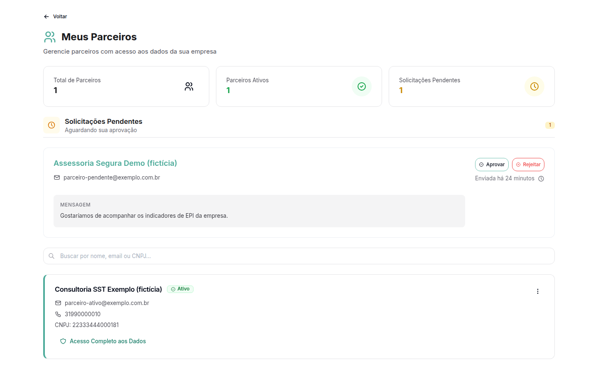
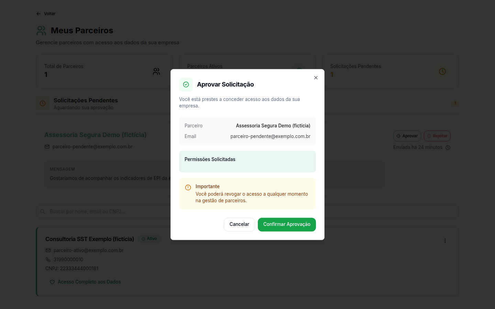
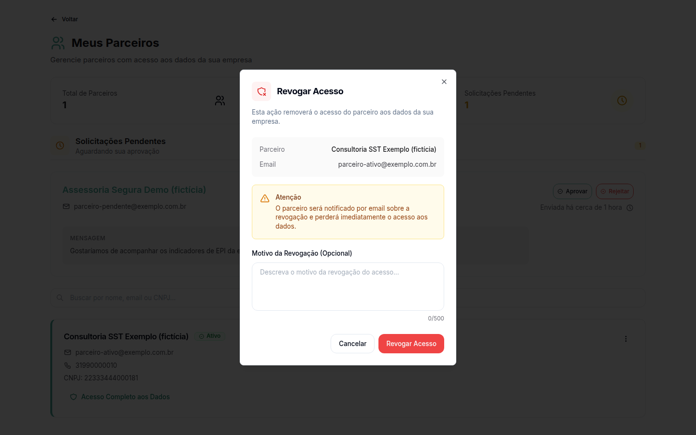

# Gerenciar os parceiros da empresa

**Para que serve:** decidir quais parceiros acessam os dados da sua empresa. Um parceiro é a revenda ou a consultoria que atende a sua empresa no GNRx.


**Quem pode fazer:** só o acesso Empresa (CNPJ).


## Antes de começar

* [Entre no sistema](../acesso/entrar-no-sistema.md) pela aba **Empresa**.

## Passo a passo



### Abra Meus Parceiros

No menu do usuário, clique em **Meus Parceiros**. A tela mostra **Total de Parceiros**, **Parceiros Ativos** e **Solicitações Pendentes**.

<figure><figcaption>
Meus Parceiros
</figcaption></figure>



### Aprove ou rejeite um pedido

Em **Solicitações Pendentes**, escolha:

* **Aprovar:** abre **Aprovar Solicitação** com as **Permissões Solicitadas** (Acesso Total ao Sistema, Visualizar Estoque Disponível e Receber Solicitações de EPI). Clique em **Confirmar Aprovação**.
* **Rejeitar:** escreva um motivo, se quiser, e clique em **Confirmar Rejeição**.

<figure><figcaption>
Aprovar Solicitação
</figcaption></figure>



### Ajuste ou revogue um acesso

Na lista de parceiros, clique em **Gerenciar Permissões** para mudar o que o parceiro pode fazer. Para tirar o acesso, clique em **Revogar Acesso**. Escreva um motivo, se quiser, e clique em **Revogar Acesso** de novo para confirmar. O parceiro será notificado por e-mail.

<figure><figcaption>
Revogar acesso
</figcaption></figure>



## Dúvidas comuns

Se eu aprovar, posso voltar atrás?

Pode. Você pode revogar o acesso a qualquer momento.

Como reconheço os usuários do parceiro?

Na lista de usuários, eles aparecem com o selo **Parceiro**.

