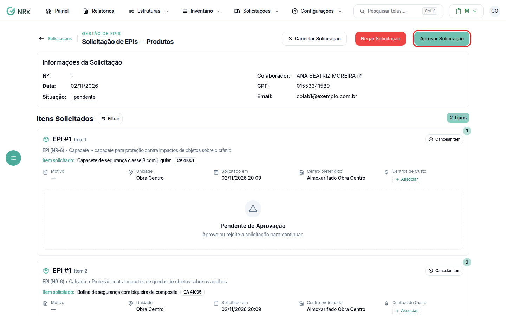

# Aprovar uma solicitação

**Para que serve:** aprovar, negar ou cancelar uma solicitação que está **Aguardando Aprovação**.


**Quem pode fazer:** Supervisor, Gestor ou Administrador, com as permissões de aprovar e rejeitar solicitações de EPI.


## Antes de começar

* Se a empresa usa [fluxo de aprovação](../fluxos-aprovacao/decidir-aprovacao.md), a decisão é pelo fluxo.

## Passo a passo



### Abra a solicitação

Em **Consultar Solicitações**, abra a solicitação. Aparece "Aprove ou rejeite a solicitação para continuar.".

<figure><figcaption>
Solicitação aguardando aprovação
</figcaption></figure>



### Decida

Clique em **Aprovar Solicitação**, escreva uma observação se quiser e clique em **Confirmar Aprovação**. Aparece "Solicitação aprovada com sucesso. O colaborador agora pode retirar os equipamentos.". Ou clique em **Negar Solicitação**, escreva o **Motivo** (opcional) e clique em **Confirmar Rejeição**.



## Dúvidas comuns

Posso avisar o colaborador?

Pode. Marque **Notificar via aplicativo** ou **Notificar por email**.

Como cancelo?

Clique em **Cancelar Solicitação**, escreva o motivo (opcional) e clique em **Confirmar Cancelamento**. Para cancelar só um item, use **Cancelar item**.

