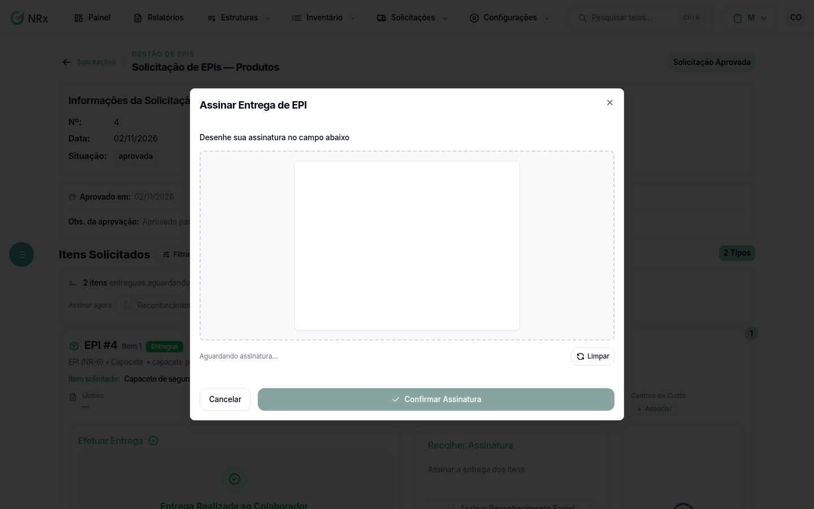

# Assinatura digital

**Para que serve:** o colaborador assina a entrega desenhando a assinatura na tela.


**Quem pode fazer:** Supervisor, Gestor ou Administrador, com a permissão de registrar entrega de EPIs.


## Antes de começar

* O item precisa estar entregue.

## Passo a passo



### Abra a assinatura

Abra a solicitação. Em **Recolher Assinatura**, clique em **Digitalmente**.

<figure><figcaption>
Assinatura digital
</figcaption></figure>



### Assine

O colaborador desenha a assinatura no campo. Para recomeçar, clique em **Limpar**. Clique em **Confirmar Assinatura**. Aparece "Entrega Assinada com sucesso!".



## Deu errado?

| Mensagem na tela | O que fazer |
| --- | --- |
| "Por favor, assine o documento antes de enviar." | Desenhe a assinatura antes de confirmar. |
| "O Item precisa ser entregue antes de realizar a assinatura." | Efetue a entrega primeiro. |
| "Erro ao processar assinatura. Tente novamente." | Tente de novo. |

## Dúvidas comuns

O colaborador não está aqui.

Mande o pedido de assinatura por **App GNRx - Colaborador**, **Email** ou **WhatsApp**. Veja [Entregar e colher a assinatura](../entrega/confirmar-entrega.md).

A assinatura saiu errada.

Use **Refazer Assinatura** no item, ou **Reassinar Todos**.

