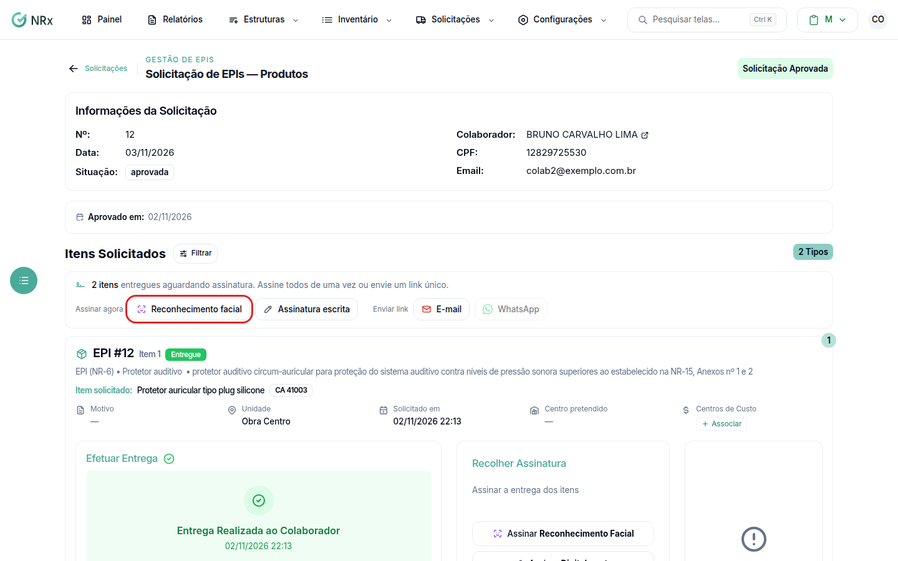

# Assinatura por reconhecimento facial

**Para que serve:** o colaborador assina a entrega olhando para a câmera.


**Quem pode fazer:** Supervisor, Gestor ou Administrador, com a permissão de registrar entrega de EPIs.


## Antes de começar

* O item precisa estar entregue.
* O rosto do colaborador precisa estar cadastrado. Veja [Cadastrar o rosto do colaborador](../../configuracoes-iniciais/reconhecimento-facial/cadastrar-face.md).
* Use um equipamento com câmera.

## Passo a passo



### Abra a câmera

Abra a solicitação. Em **Recolher Assinatura**, clique em **Reconhecimento Facial**. Se tiver mais de uma câmera, use **Selecione a câmera**.

<figure><figcaption>
Reconhecimento Facial
</figcaption></figure>



### Capture

Com o rosto do colaborador na tela, clique em **Iniciar Captura**. Aparece "Entrega Assinada com sucesso!".



## Deu errado?

| Mensagem na tela | O que fazer |
| --- | --- |
| "Permissão negada" | Permita o acesso à câmera no navegador. |
| "Câmera não encontrada" | Conecte uma câmera. |
| "Câmera em uso" | Feche outros apps que usam a câmera. |
| "Contexto inseguro" | Use HTTPS para acessar a câmera. |

## Dúvidas comuns

O botão Reconhecimento Facial está apagado.

O item ainda não foi entregue ou o rosto do colaborador não está cadastrado.

Como sei como foi assinado?

Em **Detalhes da Assinatura**, aparece se foi com reconhecimento facial ou escrita.

