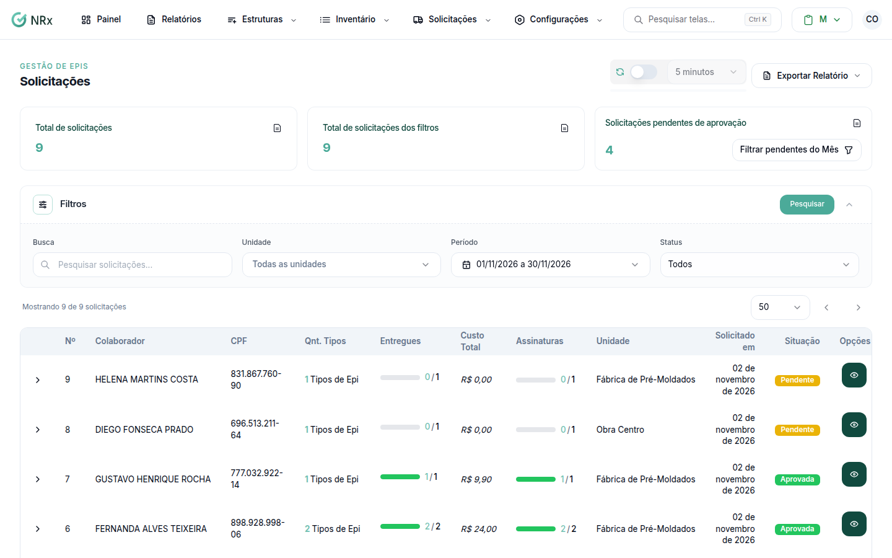

# Consultar as solicitações

**Para que serve:** achar uma solicitação e ver em que pé está a entrega.


**Quem pode fazer:** quem abre **Solicitações › Consultar Solicitações**.


## Antes de começar

* Nada a preparar.

## Passo a passo



### Abra a lista

Clique em **Solicitações › Consultar Solicitações**. O topo mostra o **Total de solicitações** e as **Solicitações pendentes de aprovação**.

<figure><figcaption>
Solicitações
</figcaption></figure>



### Pesquise e filtre

Digite em **Pesquisar solicitações...** e use **Filtrar por status** (**Pendente**, **Aprovada**, **Cancelada**...). Abra a solicitação para ver os itens.



## Dúvidas comuns

Posso exportar?

Pode. Exporte os filtrados para Excel.

Apareceu "Nenhuma solicitação encontrada".

Ajuste os filtros ou clique em **Limpar Pesquisa**.

