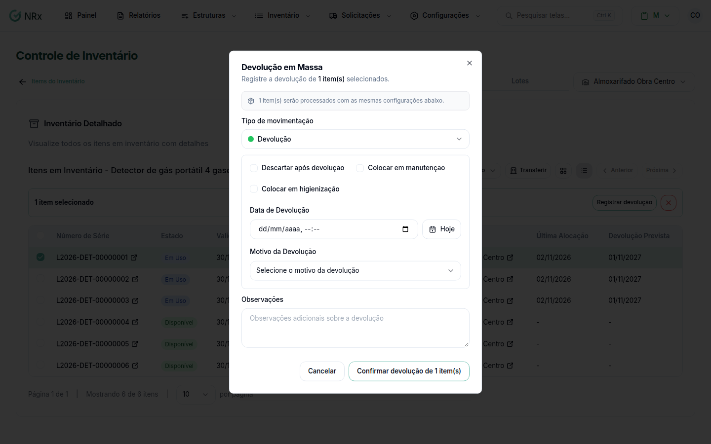

# Devolver várias unidades de uma vez

**Para que serve:** registrar de uma vez a devolução, a perda ou a quebra de várias unidades de um item que estão com os colaboradores.


**Quem pode fazer:** Supervisor, Gestor ou Administrador, com a permissão de processar devolução de EPIs.


## Antes de começar

* As unidades precisam estar **Em Uso**.

## Passo a passo



### Marque as unidades

Abra o [estoque do item](../../gestao-estoque/itens/estoque-atual.md) e marque as unidades **Em Uso**. Clique em **Registrar devolução**.

<figure><figcaption>
Devolução em Massa
</figcaption></figure>



### Preencha

Em **Tipo de movimentação**, escolha **Devolução**, **Perda** ou **Quebra** e informe a data e o motivo. Na devolução, escolha se quer **Descartar após devolução**, **Colocar em manutenção** ou **Colocar em higienização** (com a **Lavanderia**, o **Retorno previsto** e o **Custo da lavagem**).



### Confirme

Clique em **Confirmar devolução**. Aparece "Todos os itens foram devolvidos com sucesso.".



## Deu errado?

| Mensagem na tela | O que fazer |
| --- | --- |
| "Nenhum item foi devolvido. Verifique os erros." | Veja o motivo de cada item em **Resultado da Devolução em Massa**. |
| Alguns item(s) devolvido(s), outros com falha | Veja os itens com falha em **Resultado da Devolução em Massa** e registre-os um a um. |
| "Preencha todos os campos necessários para o tipo selecionado" | Preencha a data e o motivo. |

## Dúvidas comuns

Não aparece o botão Registrar devolução.

Ele só aparece quando todas as unidades marcadas estão **Em Uso**. Com outras unidades marcadas, aparece a troca de estado.

Quero devolver só um item.

Veja [Registrar uma devolução](registrar-devolucao.md).

