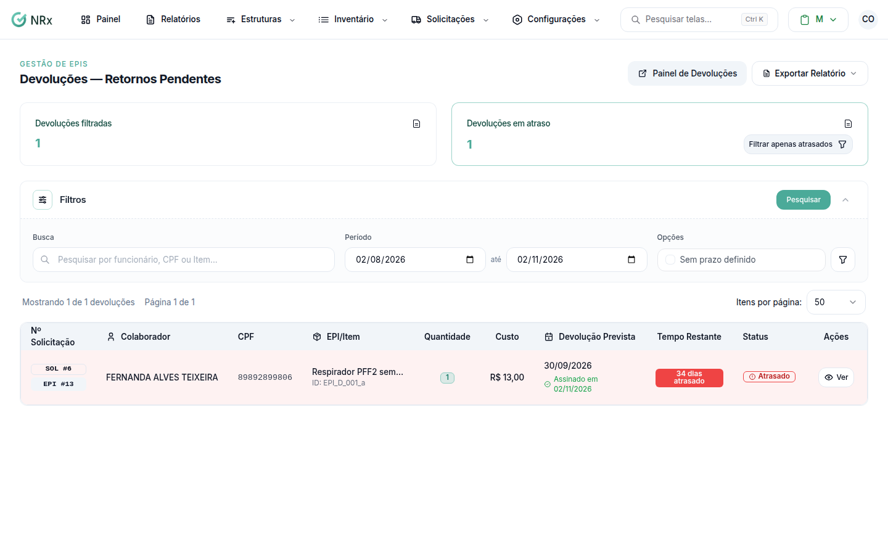

# Ver as devoluções pendentes

**Para que serve:** ver os EPIs que precisam voltar, os que estão atrasados e os que já voltaram.


**Quem pode fazer:** Supervisor, Gestor ou Administrador, com a permissão de processar devolução de EPIs.


## Antes de começar

* Nada a preparar.

## Passo a passo



### Abra as devoluções

Clique em **Solicitações › Devoluções — Retornos Pendentes**. Ligue **Filtrar apenas atrasados** para ver só o que passou do prazo.

<figure><figcaption>
Devoluções — Retornos Pendentes
</figcaption></figure>



### Veja o prazo

Cada linha mostra a **Devolução Prevista** e o **Tempo Restante**: **Devolvido**, **Atrasado**, **Vencendo**, **Pendente** ou **Sem prazo**. Clique em **Ver** para abrir.



## Dúvidas comuns

Como registro a devolução?

Veja [Registrar uma devolução](registrar-devolucao.md).

Tem um painel?

Sim, o **Painel de Devoluções**.

