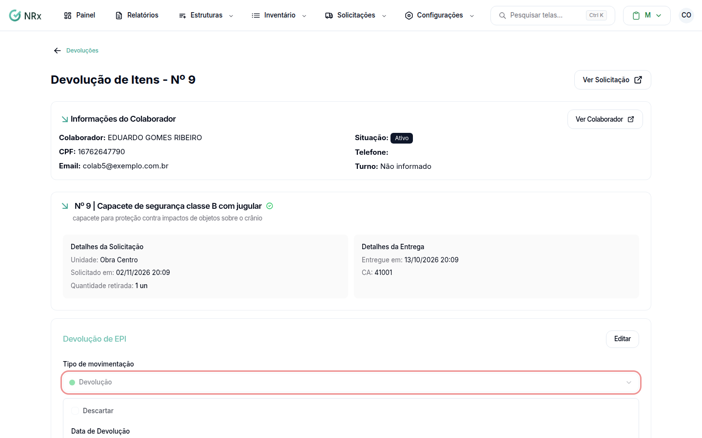

# Registrar uma devolução

**Para que serve:** registrar que o colaborador devolveu o EPI, e para onde ele vai (estoque, manutenção, higienização).


**Quem pode fazer:** Supervisor, Gestor ou Administrador, com a permissão de processar devolução de EPIs.


## Antes de começar

* O EPI precisa estar entregue e assinado.

## Passo a passo



### Abra a devolução

Abra a solicitação e clique em **Efetuar Devolução**.

<figure><figcaption>
Efetuar Devolução
</figcaption></figure>



### Preencha

Em **Tipo de movimentação**, escolha **Devolução**. Informe a **Data de Devolução** e o **Motivo da Devolução**. Diga o destino do item: **Descartar**, **Manutenção** ou **Higienização** (com a **Lavanderia**, o **Retorno previsto** e o **Custo da lavagem**). Clique em **Confirmar**. Aparece "Devolução efetuada com sucesso.".



## Deu errado?

| Mensagem na tela | O que fazer |
| --- | --- |
| "O EPI precisa ser entregue antes de iniciar o processo de devolução." | Efetue a entrega primeiro. |
| "Antes de devolver o EPI, é necessário assinar todos os itens." | Colha a assinatura. |
| "Não há itens disponíveis para devolução." | Nada a devolver nesta solicitação. |
| "Não existem motivos cadastrados para devolução" | Cadastre um [motivo de devolução](../../configuracoes-gerais/motivos/motivos-devolucao.md). |

## Dúvidas comuns

E se o EPI foi perdido ou quebrou?

Veja [Registrar perda](registrar-perda.md) e [Registrar quebra](registrar-quebra.md).

O item é descartável.

Itens **Sem devolução** não aparecem no painel de devoluções.

