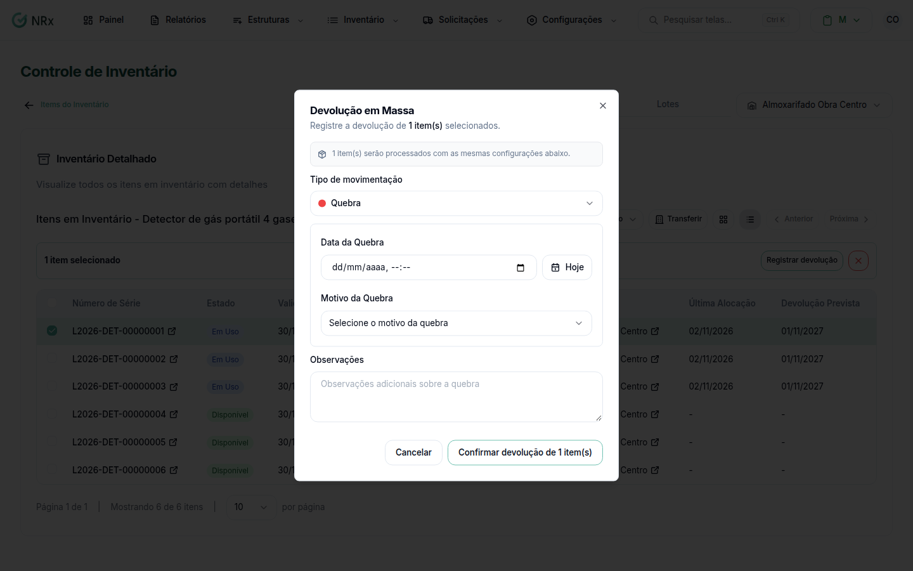

# Registrar uma quebra

**Para que serve:** registrar que o colaborador não vai devolver o EPI porque ele foi quebrado.


**Quem pode fazer:** Supervisor, Gestor ou Administrador, com a permissão de processar devolução de EPIs.


## Antes de começar

* O EPI precisa estar entregue e assinado.
* Cadastre os [motivos de quebra](../../configuracoes-gerais/motivos/motivos-quebra.md).

## Passo a passo



### Abra a devolução

Abra a solicitação e clique em **Efetuar Devolução**.

<figure><figcaption>
Quebra
</figcaption></figure>



### Preencha

Em **Tipo de movimentação**, escolha **Quebra**. Informe a **Data da Quebra** e o **Motivo da Quebra**. Se quiser, escreva as **Observações**. Clique em **Confirmar**.



## Deu errado?

| Mensagem na tela | O que fazer |
| --- | --- |
| "Não existem motivos cadastrados para quebra" | Cadastre um [motivo de quebra](../../configuracoes-gerais/motivos/motivos-quebra.md). |
| "Preencha todos os campos necessários para o tipo selecionado" | Preencha a data e o motivo. |
| "Antes de devolver o EPI, é necessário assinar todos os itens." | Colha a assinatura. |

## Dúvidas comuns

Como fica o item depois?

Ele aparece como **Reportado como Quebrado**.

Errei a data ou o motivo.

Abra a movimentação e clique em **Editar**.

