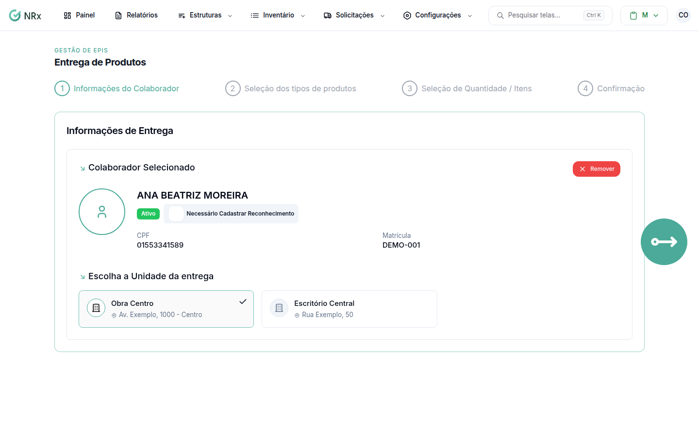

# Entregar produtos

**Para que serve:** entregar produtos que não são EPI (uniformes, ferramentas) a um colaborador.


**Quem pode fazer:** Supervisor, Gestor ou Administrador, com a permissão de registrar entrega de EPIs.


## Antes de começar

* O produto precisa estar no inventário, com estoque.

## Passo a passo



### Escolha o colaborador

Clique em **Solicitações › Entregar Produtos**. Em **Informações do Colaborador**, escolha o funcionário e o local de trabalho.

<figure><figcaption>
Entrega de Produtos
</figcaption></figure>



### Escolha os produtos

Em **Seleção dos tipos de produtos** e **Seleção de Quantidade / Itens**, escolha os produtos e as quantidades. Em **Motivo da Nova Entrega**, use **Selecionar Motivo**.



### Conclua

Confirme. Aparece **Entrega de Produtos realizada com sucesso!**. Se precisar, clique em **Assinar Agora**.



## Deu errado?

| Mensagem na tela | O que fazer |
| --- | --- |
| "Selecione pelo menos um item" | Escolha um produto. |
| "Todos os itens precisam ter unidades ou conjuntos selecionados" | Escolha as unidades de cada item. |

## Dúvidas comuns

Onde vejo a entrega depois?

Clique em **Ir para a Solicitação**.

Quero entregar outro.

Clique em **Nova Entrega**.

