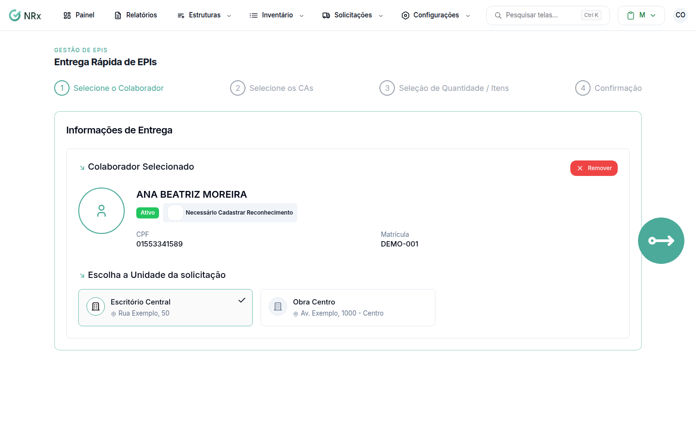

# Fazer uma entrega rápida

**Para que serve:** solicitar e entregar EPIs de uma vez só, com a assinatura do colaborador na hora.


**Quem pode fazer:** Supervisor, Gestor ou Administrador, com a permissão de registrar entrega de EPIs.


## Antes de começar

* Tenha o colaborador por perto para assinar.

## Passo a passo



### Escolha o colaborador e os itens

Clique em **Solicitações › Entrega Rápida**. Em **Selecione o Colaborador**, escolha a pessoa. Em **Selecione os CAs**, escolha os EPIs e, em **Seleção de Quantidade / Itens**, as unidades.

<figure><figcaption>
Entrega Rápida de EPIs
</figcaption></figure>



### Defina o motivo

Em **Motivo da Nova Entrega**, use **Selecionar Motivo** em cada item.



### Assine

Colha a assinatura (**Assinatura Digital** ou **Reconhecimento Facial**). Aparece **Entrega realizada com sucesso!**.



## Deu errado?

| Mensagem na tela | O que fazer |
| --- | --- |
| "Todos os EPIs precisam ter um motivo de solicitação definido" | Escolha o motivo de cada item. |
| "Por favor, selecione um centro de estoque" | Escolha o centro de estoque. |
| "Por favor, assine antes de continuar" | Colha a assinatura. |

## Dúvidas comuns

A data da entrega que informei foi ignorada.

Com assinatura obrigatória, a entrega é registrada no momento da assinatura.

O colaborador tem EPIs não devolvidos.

A tela mostra **EPIs não devolvidos**. Confira antes de entregar outro.

