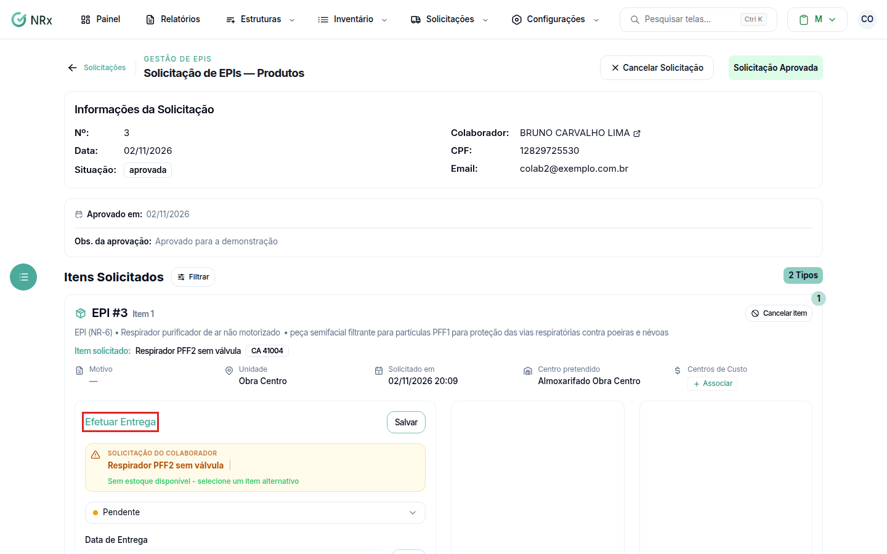

# Entregar e colher a assinatura

**Para que serve:** registrar a entrega dos itens aprovados e colher a assinatura do colaborador.


**Quem pode fazer:** Supervisor, Gestor ou Administrador, com a permissão de registrar entrega de EPIs.


## Antes de começar

* A solicitação precisa estar aprovada.

## Passo a passo



### Efetue a entrega

Abra a solicitação e clique em **Efetuar Entrega**. Escolha os itens do estoque e salve.

<figure><figcaption>
Efetuar Entrega
</figcaption></figure>



### Colha a assinatura

Em **Recolher Assinatura**, escolha **Digitalmente** ou **Reconhecimento Facial**. Veja [Assinatura digital](../assinatura/assinatura-digital.md) e [Assinatura por reconhecimento facial](../assinatura/assinatura-reconhecimento-facial.md). Aparece "Entrega Assinada com sucesso!".




**Pelo celular do colaborador:** use **App GNRx - Colaborador**, **Email** ou **WhatsApp** para mandar o pedido de assinatura. O **WhatsApp** só funciona com a integração de WhatsApp ligada.


## Deu errado?

| Mensagem na tela | O que fazer |
| --- | --- |
| "O Item precisa ser entregue antes de realizar a assinatura." | Efetue a entrega primeiro. |
| "Documentação irregular impede receber itens: ... Regularize os documentos ou solicite uma liberação excepcional." | Com o bloqueio documental ligado, regularize os documentos no módulo Gestão de Documentos ou peça lá uma liberação excepcional. |

## Dúvidas comuns

Vejo o custo dos itens?

O custo unitário só aparece para quem tem a permissão de ver o custo unitário dos itens (Gestor e Administrador).

Preciso refazer a assinatura.

Use **Refazer Assinatura**: "Colete uma nova assinatura para substituir a anterior". Aparece "Assinatura refeita com sucesso".

