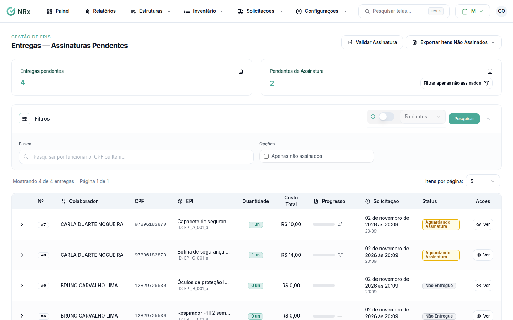

# Ver as assinaturas pendentes

**Para que serve:** ver as entregas que ainda não foram assinadas e cobrar a assinatura.


**Quem pode fazer:** Supervisor, Gestor ou Administrador, com a permissão de registrar entrega de EPIs.


## Antes de começar

* Nada a preparar.

## Passo a passo



### Abra as pendências

Clique em **Solicitações › Entregas — Assinaturas Pendentes**. Ligue **Apenas não assinados** para ver só o que falta.

<figure><figcaption>
Entregas — Assinaturas Pendentes
</figcaption></figure>



### Cobre a assinatura

Abra a entrega e colha a assinatura ou notifique o colaborador. Veja [Entregar e colher a assinatura](confirmar-entrega.md).



## Dúvidas comuns

Como levo a lista para uma reunião?

Use **Exportar Itens Não Assinados**: **Exportar como PDF** ou **Exportar para Excel**, por colaborador, unidade e período.

O que significa "Em Trânsito"?

O item foi enviado e ainda não chegou ao colaborador.

