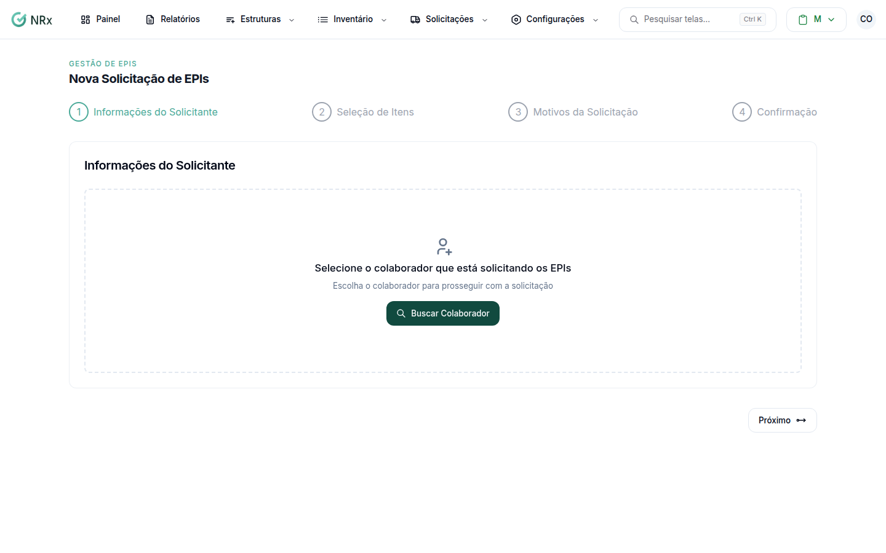

# Fazer uma solicitação de EPI

**Para que serve:** pedir EPIs para um colaborador, com o motivo de cada item.


**Quem pode fazer:** todas as roles, com a permissão de solicitar EPIs.


## Antes de começar

* O colaborador precisa estar cadastrado e ativo.

## Passo a passo



### Escolha o colaborador

Clique em **Solicitações › Nova Solicitação**. Em **Informações do Solicitante**, busque o colaborador pelo nome ou CPF.

<figure><figcaption>
Nova Solicitação de EPIs
</figcaption></figure>



### Selecione os itens

Em **Seleção de Itens**, busque por nome, CA ou tipo e escolha os itens. Para ver também produtos, ligue **Exibir Produtos**. Itens **Sem estoque** aparecem marcados.



### Defina os motivos

Em **Motivos da Solicitação**, use **Selecionar Motivo** em cada item. Clique em **Próximo**, revise a **Confirmação** e clique em **Confirmar Solicitação**. Aparece **Solicitação criada com sucesso!**.



## Deu errado?


**"Todos os EPIs precisam ter um motivo de solicitação definido"**: escolha o motivo de cada item.


## Dúvidas comuns

E depois de criar?

Se precisar de aprovação, ela aguarda. Se já está pronta, use **Ir para entrega**.

Quero pedir e entregar na hora.

Use a [Entrega Rápida](entrega-rapida.md).

