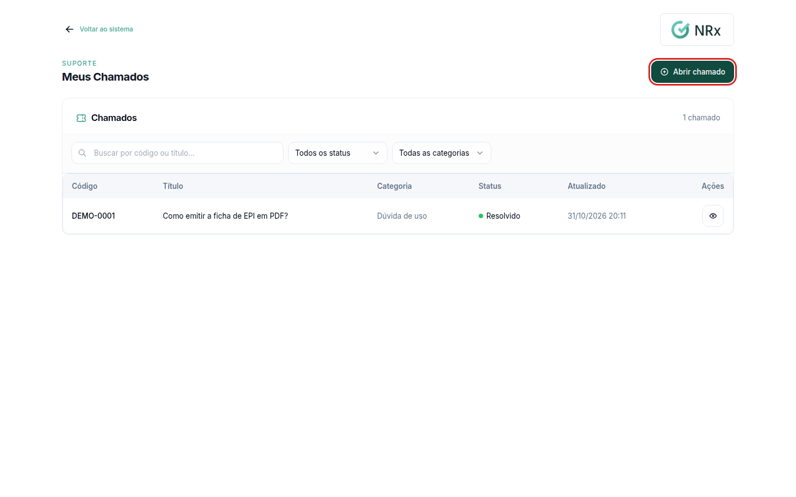
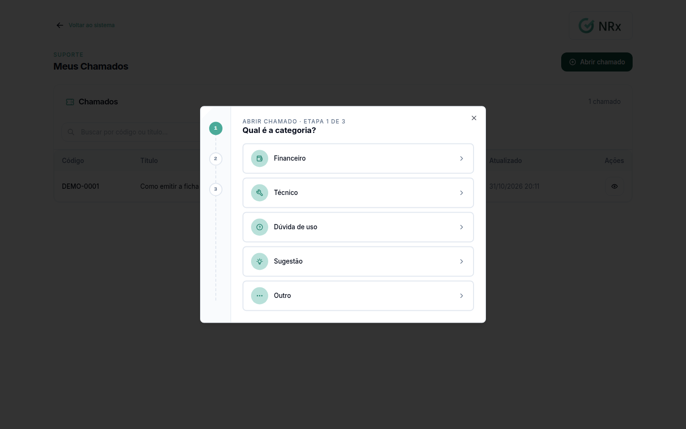
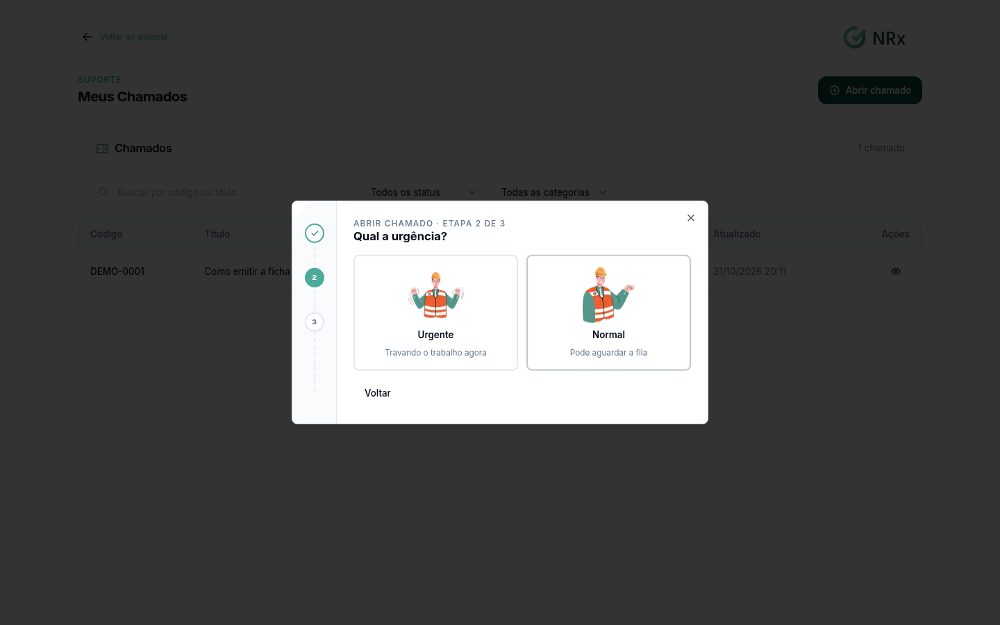
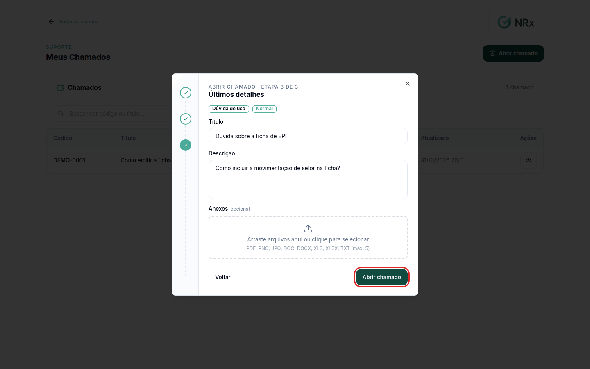

# Abrir um chamado de suporte

**Para que serve:** pedir ajuda ao suporte GNRx quando algo não funciona ou quando você tem uma dúvida.


**Quem pode fazer:** todas as roles (Operador, Supervisor, Gestor e Administrador), com a permissão de abrir chamados de suporte.


## Antes de começar

* Se puder, tire um print da tela com o problema para anexar.

## Passo a passo



### Abra os seus chamados

No menu do usuário, clique em **Suporte › Meus Chamados**. Clique em **Abrir chamado de suporte**.

<figure><figcaption>
Meus Chamados
</figcaption></figure>



### Escolha a categoria

Em **Qual é a categoria?**, escolha a que mais combina com o seu caso.

<figure><figcaption>
Categoria
</figcaption></figure>



### Escolha a urgência

Em **Qual a urgência?**, escolha:

* **Urgente:** travando o trabalho agora;
* **Normal:** pode aguardar a fila.

<figure><figcaption>
Urgência
</figcaption></figure>



### Descreva e envie

Escreva um título com o resumo do problema ou da dúvida (de 3 a 255 caracteres). Na descrição, detalhe o que está acontecendo. Se tiver, adicione **Anexos**. Clique em **Abrir chamado**. Aparece **Chamado aberto**.

<figure><figcaption>
Título, descrição e anexos
</figcaption></figure>



Depois, [acompanhe o chamado](acompanhar-chamado.md).

## Dúvidas comuns

Quando marco Urgente?

Quando o problema está travando o seu trabalho agora. Para o resto, use **Normal**.

Outras pessoas da empresa veem o meu chamado?

Os chamados ficam visíveis para quem tem a permissão de ver os chamados de suporte da empresa. Por padrão, todas as roles têm.

