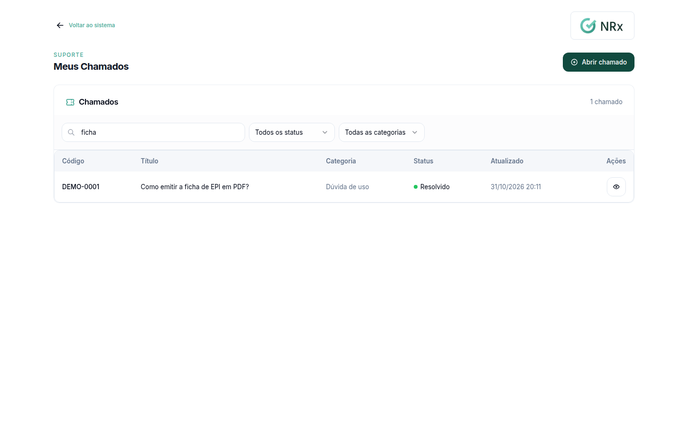
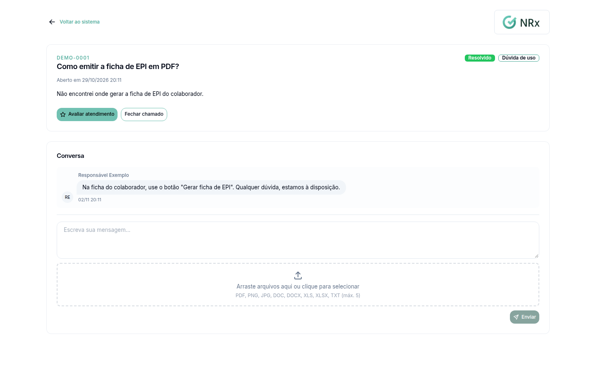

# Acompanhar um chamado de suporte

**Para que serve:** ver o andamento de um chamado, responder ao suporte e fechar ou cancelar o chamado.


**Quem pode fazer:** todas as roles (Operador, Supervisor, Gestor e Administrador), com as permissões de ver, comentar e fechar chamados de suporte.


## Antes de começar

* [Abra um chamado](abrir-chamado.md).

## Passo a passo



### Encontre o chamado

No menu do usuário, clique em **Suporte › Meus Chamados**. Digite em **Buscar por código ou título...** ou use os filtros **Status** e **Categoria**. Clique no chamado.

<figure><figcaption>
Busca de chamados
</figcaption></figure>



### Responda o suporte

No chamado, escreva o seu comentário e envie.

<figure><figcaption>
Chamado aberto
</figcaption></figure>



### Feche ou cancele

* Problema resolvido? Clique em **Fechar chamado**. Aparece "Chamado fechado com sucesso.".
* Não precisa mais de ajuda? Clique em **Cancelar chamado**. Aparece "Chamado cancelado.".



## Dúvidas comuns

Como acho um chamado antigo?

Use **Buscar por código ou título...** ou o filtro **Status**.

Quem responde o meu chamado?

O suporte GNRx. A resposta aparece nos comentários do chamado.

