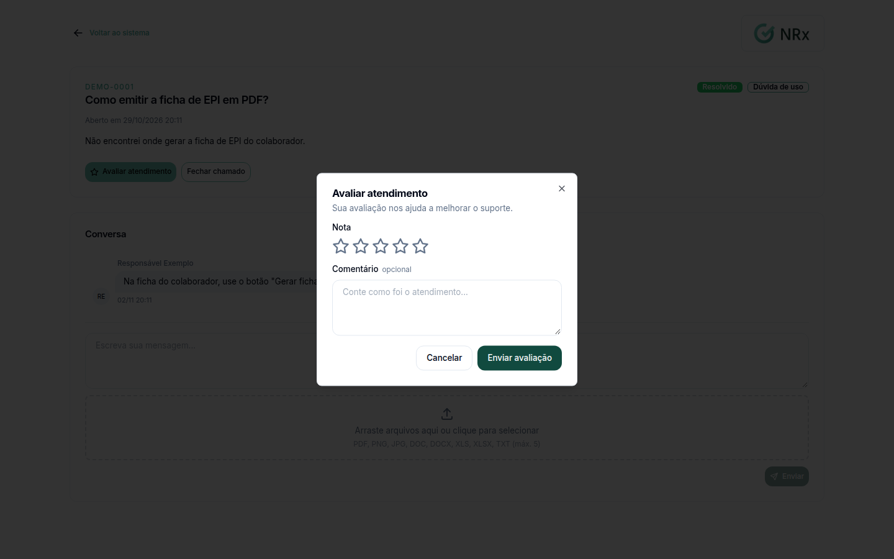

# Acompanhar um chamado de suporte

**Para que serve:** ver o andamento de um chamado, responder ao suporte e fechar ou cancelar o chamado.


**Quem pode fazer:** todas as roles (Operador, Supervisor, Gestor e Administrador), com as permissões de ver, comentar, fechar e avaliar chamados de suporte.


## Antes de começar

* [Abra um chamado](abrir-chamado.md).

## Passo a passo



### Encontre o chamado

No menu do usuário, clique em **Suporte**. Digite em **Buscar por código ou título...** ou use os filtros **Status** e **Categoria**. Clique no chamado.

<figure><figcaption>
Busca de chamados
</figcaption></figure>



### Responda o suporte

Escreva em **Escreva sua mensagem...** e clique em **Enviar**.

<figure><figcaption>
Chamado aberto
</figcaption></figure>



### Feche ou cancele

* **Cancelar chamado** só aparece enquanto o chamado está Aberto e ninguém da GNRx assumiu. Aparece "Chamado cancelado.".
* **Fechar chamado** só aparece quando o chamado está Resolvido. Aparece "Chamado fechado com sucesso.".



### Avalie o atendimento

Com o chamado Resolvido ou Fechado, dê uma nota de 1 a 5 estrelas. Se quiser, escreva em **Conte como foi o atendimento...**. Clique em **Enviar avaliação**.

<figure><figcaption>
Avaliar o atendimento
</figcaption></figure>



## Dúvidas comuns

Como acho um chamado antigo?

Use **Buscar por código ou título...** ou o filtro **Status**.

Posso comentar num chamado fechado?

Não. Chamado Fechado ou Cancelado fica encerrado e não aceita mais comentários. Se precisar, abra outro.

Quem responde o meu chamado?

O suporte GNRx. A resposta aparece nos comentários do chamado.

