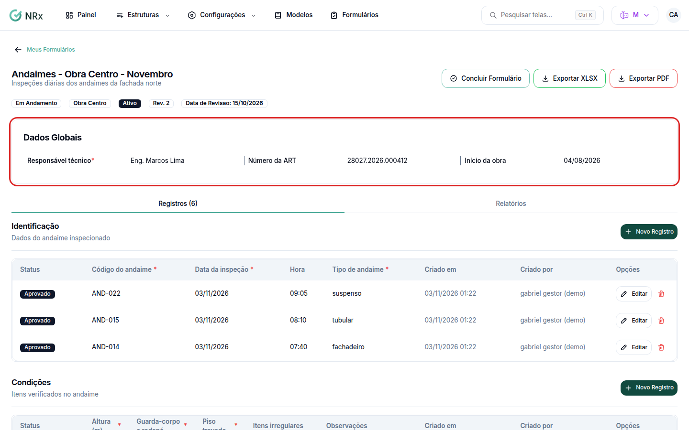

# Preencher os dados globais

**Para que serve:** preencher os dados que valem para o formulário inteiro, não para cada registro. Ex.: local, responsável, assinatura de quem conferiu.


**Quem pode fazer:** todas as roles, com a permissão de preencher registros.


## Antes de começar

* O modelo precisa ter dados globais (veja [Criar um modelo](modelos-de-formularios/criar-modelo.md)).

## Passo a passo



### Abra o formulário

Em **Meus Formulários**, abra o formulário. No topo fica **Dados Globais**.

<figure><figcaption>
Dados Globais
</figcaption></figure>



### Preencha

Cada dado é salvo separado. Clique no ícone de lápis do dado, preencha e clique no ícone de check para salvar (ou no x para cancelar). Para foto, use **Clique para selecionar**. Para assinatura, clique em **Assinar**, desenhe e clique em **Salvar**.



## Deu errado?


**"Falha ao atualizar dado. Verifique se o arquivo está sendo enviado corretamente."**: a foto ou a assinatura não foi enviada. Tente de novo.


## Dúvidas comuns

A foto não foi aceita.

Envie PNG ou JPG, até 10 MB.

Errei a assinatura.

Use **Limpar** e assine de novo.

