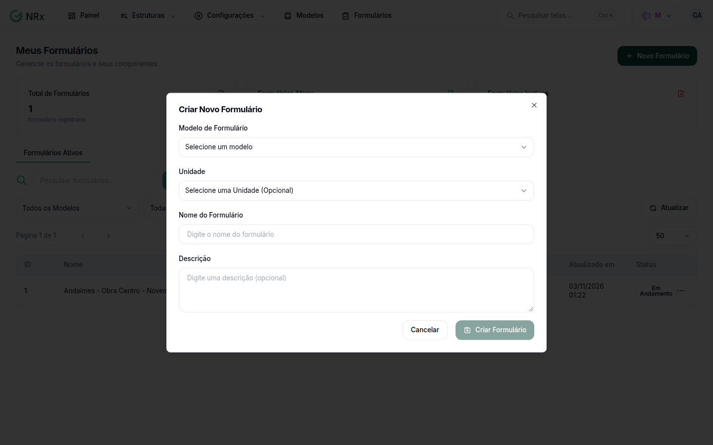

# Criar um formulário

**Para que serve:** abrir um formulário novo, a partir de um modelo, para a equipe lançar os registros. Ex.: inspeção de extintores de novembro.


**Quem pode fazer:** todas as roles, com a permissão de criar formulários.


## Antes de começar

* Tenha um [modelo](modelos-de-formularios/criar-modelo.md) criado.

## Passo a passo



### Abra o novo formulário

Clique em **Meus Formulários** e em **Novo Formulário**.

<figure><figcaption>
Criar Novo Formulário
</figcaption></figure>



### Preencha

Escolha o **Modelo de Formulário** e, se quiser, a **Unidade**. Informe o **Nome do Formulário** e, se quiser, a **Descrição**.



### Crie

Clique em **Criar Formulário**. Aparece "Formulário criado com sucesso".



## Deu errado?

| Mensagem na tela | O que fazer |
| --- | --- |
| "Selecione um modelo" | Escolha o modelo. |
| "Nome é obrigatório" | Informe o nome. |
| "Erro ao criar formulário" | Tente de novo. |

## Dúvidas comuns

E agora?

Abra o formulário e lance os registros. Veja [Lançar os registros de um formulário](visualizar-registros.md).

Pelo celular?

Também dá. Veja o [aplicativo](../aplicativo/criando-novo-formulario.md).

