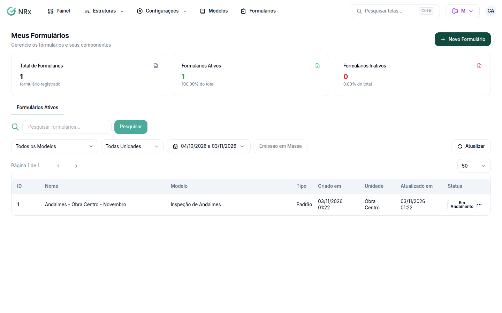

# Encontrar um formulário

**Para que serve:** achar um formulário e abrir os registros dele.


**Quem pode fazer:** todas as roles, com a permissão de ver formulários.


## Antes de começar

* Nada a preparar.

## Passo a passo



### Abra a lista

Clique em **Meus Formulários**. O topo mostra o **Total de Formulários**, os **Formulários Ativos** e os **Formulários Inativos**.

<figure><figcaption>
Meus Formulários
</figcaption></figure>



### Filtre e abra

Use **Pesquisar formulários...**, o **Modelo** e a **Unidade**. Na linha, abra **Ações** e clique em **Visualizar**.



## Dúvidas comuns

O que significa cada situação?

**Em Andamento** (recebe registros), **Concluído** (fechado para alteração) ou **Cancelado**.

Quero o PDF de vários formulários.

Veja [Emitir vários formulários em um PDF](relatorios/relatorio-consolidado.md).

