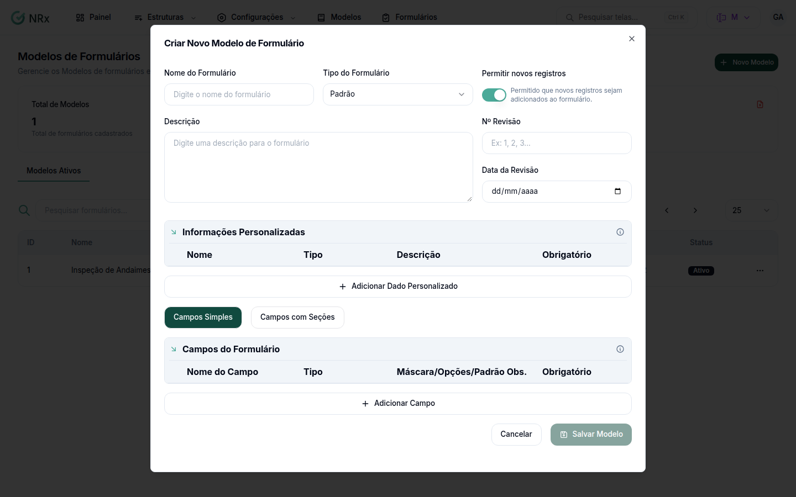

# Criar um modelo de formulário

**Para que serve:** definir um formulário que a equipe vai preencher várias vezes. Ex.: inspeção diária de extintores.


**Quem pode fazer:** Gestor ou Administrador, com a permissão de criar modelos de formulário.


## Antes de começar

* Liste os campos que o formulário precisa ter.

## Passo a passo



### Abra o novo modelo

Clique em **Modelos de Formulário** e em **Novo Modelo**.

<figure><figcaption>
Criar Novo Modelo de Formulário
</figcaption></figure>



### Preencha os dados

Informe o **Nome do Formulário** e o **Tipo do Formulário** (**Padrão**, **Checklist** ou **Auditoria**). Se quiser, escreva a **Descrição** e informe o **Nº Revisão** e a **Data da Revisão**. Deixe **Permitir novos registros** ligado para a equipe poder lançar registros.



### Adicione os dados globais (se quiser)

Dados globais são preenchidos uma vez por formulário (ex.: local, responsável). Clique em **Adicionar Dado Personalizado** e informe o nome, o tipo e se é obrigatório.



### Adicione os campos

Escolha **Campos Simples** ou **Campos com Seções** e use **Adicionar Campo**. Veja [Adicionar campos ao modelo](editor-de-campos.md).



### Salve

Clique em **Salvar Modelo**. Aparece "Modelo criado com sucesso".



## Deu errado?


**"Data da revisão inválida. O campo será ignorado."**: o modelo é salvo sem a data. Corrija a data editando o modelo.


## Dúvidas comuns

Qual tipo escolher?

**Padrão** para formulários comuns, **Checklist** para listas de verificação e **Auditoria** para formulários de auditoria.

Posso mudar depois?

Pode. Veja [Editar, revisar ou inativar um modelo](versionamento.md).

